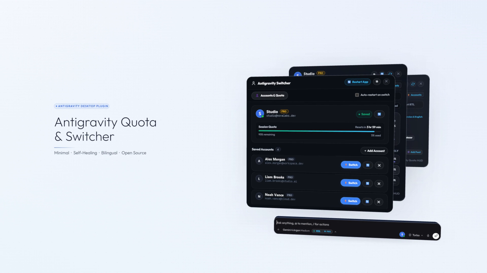
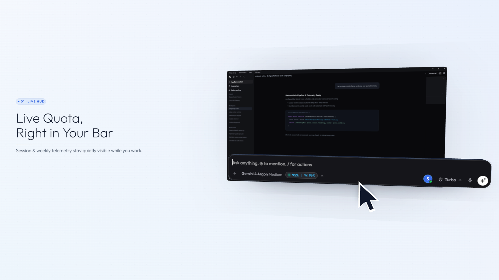
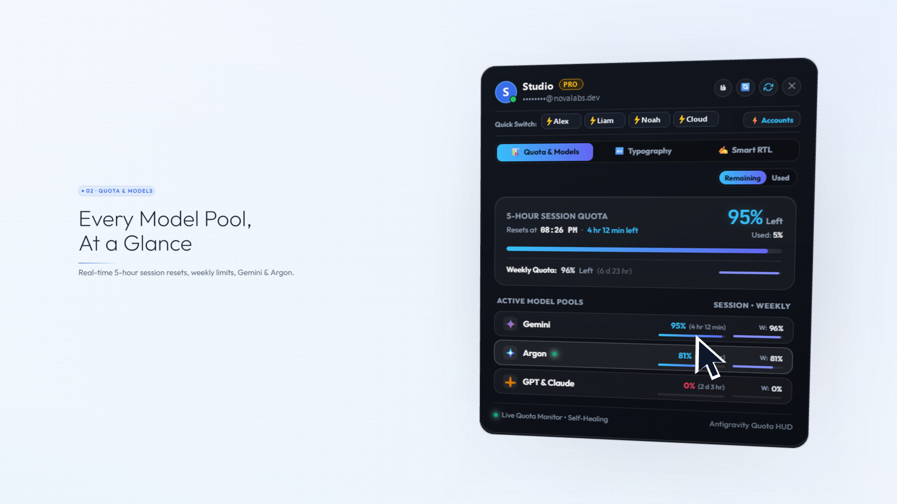
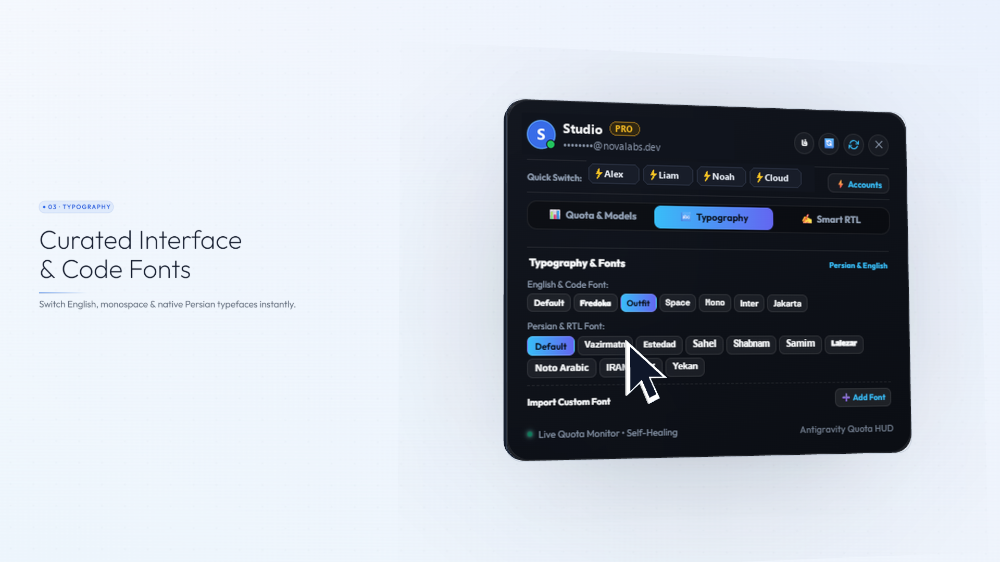
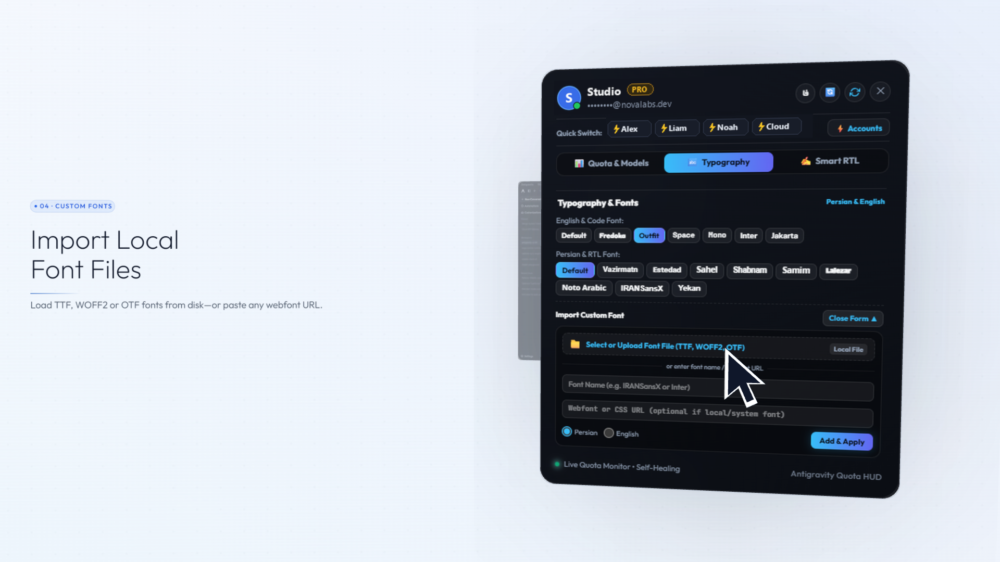
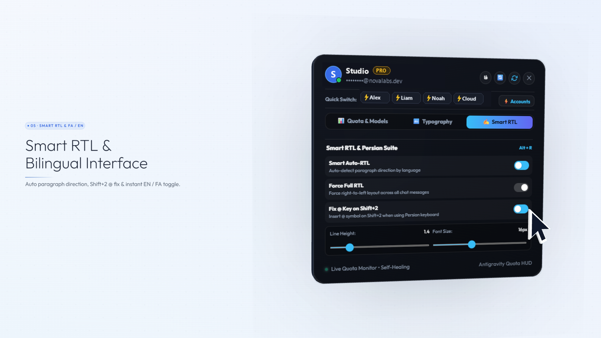
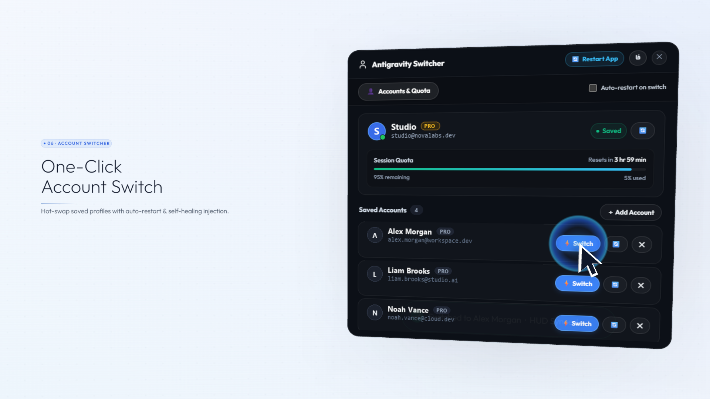
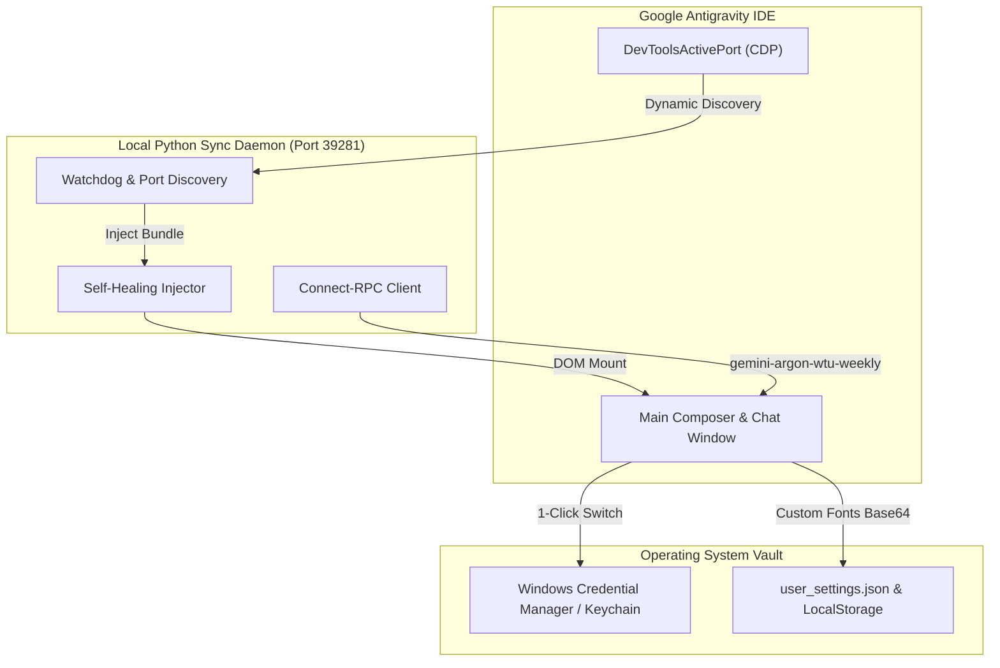

# Antigravity Quota HUD & Account Switcher ⚡️

[](LICENSE)
[]()
[]()
[]()
[]()
[]()
[](https://github.com/mad-helpers)

> **Minimal, super-fast 1-click Google Account Switcher, Real-Time Quota HUD (Gemini, Argon, Claude/GPT), Smart Persian RTL Suite, and Custom Local Font Engine for Google Antigravity & AI IDEs.**  
> Built with precision, liquid glass aesthetics, fluid 60fps physics, self-healing CDP injection, and native bilingual support (English & Persian).

<p align="center">
  
</p>

---

## 🎬 Official 1080p 60fps Feature Teaser

Experience the complete feature walkthrough—choreographed in **Three.js** with spatial 3D slab physics, mouse-driven interactions, subtle UI foley audio, and light **Outfit** typography.

<p align="center">
  <a href="assets/teaser.mp4">
    
    <br>
    <b>▶️ Click here to watch the full 1080p 60fps Teaser Video (`assets/teaser.mp4`)</b>
  </a>
</p>

---

## 🌟 Quick Navigation / منوی دسترسی سریع

- [English Overview & Architecture](#-english)
- [فارسی (🇮🇷 مستندات جامع فارسی)](README_FA.md)
- [🚀 1-Line Installation](#-installation)
- [📸 Feature Showcase & Visual Tour](#-feature-showcase)
- [⌨️ CLI Reference (`agy-switch`, `agy-quota`)](#-cli-commands--utilities)
- [🤖 Model Context Protocol (MCP) Server](#-model-context-protocol-mcp-server)
- [🛠 Architecture & Self-Healing Pipeline](#-architecture--how-it-works)
- [📄 License & Authors](#-license)

---

## 🚀 Installation

### 🪟 Windows 10 & 11 (PowerShell — Recommended)
Open Windows PowerShell (Run as standard user) and paste:
```powershell
irm https://raw.githubusercontent.com/mad-helpers/antigravity-account-switcher/master/install.ps1 | iex
```
*✨ What this script does automatically:*
- Registers the self-healing background synchronization service (`sync_daemon.py`).
- Adds global CLI binaries (`agy-switch` and `agy-quota`) directly to your system `PATH`.
- Installs the in-editor bundle into `%USERPROFILE%\.gemini\antigravity\`.
- Automatically connects to Antigravity's active DevTools debugging port via `DevToolsActivePort`.

### 🍏 macOS & 🐧 Linux (Bash)
Open your terminal and run:
```bash
curl -fsSL https://raw.githubusercontent.com/mad-helpers/antigravity-account-switcher/master/install.sh | bash
```

### 📦 Manual / Portable Setup
```bash
git clone https://github.com/mad-helpers/antigravity-account-switcher.git
cd antigravity-account-switcher

# Windows:
.\install.ps1

# macOS / Linux:
chmod +x install.sh && ./install.sh
```

---

## 📸 Feature Showcase

### 1. ⚡️ Live Quota HUD in Prompt Composer
<p align="center">
  
</p>

- **Discrete Status Capsule:** A modern, non-intrusive pill placed directly beside `Turbo` in the prompt composer (`● 95% | W: 96%`).
- **Amber Gold Activity Pulse:** Automatically radiates a warm golden glow (`#fbbf24`) whenever an active AI agent or model is streaming and consuming quota.
- **Online Service Dot:** Real-time green indicator verifying CDP daemon health and telemetry sync.

---

### 2. 📊 Real-Time Model Pools Telemetry
<p align="center">
  
</p>

- **5-Hour Session Quota:** Real-time limit with live countdown timer (`Resets in 3 hr, 59 min`).
- **Weekly Quota:** 7-day aggregate burn rate indicator (`W: 96%`).
- **Gemini 4 Argon Direct Telemetry:** Connects to Antigravity Language Server via Connect-RPC (`gemini-argon-wtu-weekly`) for sub-second precision on `gemini-4-argon` quotas and reset dates.
- **Claude Sonnet & GPT-OSS:** Unified tracking for third-party integrated models.

---

### 3. 🔤 Curated Interface & Code Fonts
<p align="center">
  
</p>

- **Handcrafted Latin & Code Typefaces:** `Outfit`, `Inter`, `Space Grotesk`, `JetBrains Mono`, `Fredoka`, `Plus Jakarta Sans`.
- **10 Built-in Persian & Arabic Fonts:** `Vazirmatn (وزیرمتن)`, `Estedad (استعداد)`, `Sahel (ساحل)`, `Shabnam (شبنم)`, `Samim (صمیم)`, `Lalezar (لاله‌زار)`, `Noto Sans Arabic`, `IRANSansX`, `B Yekan`.
- **Instant Live Switch:** Click any typeface chip to immediately re-render conversation text and editor UI without page reloads.

---

### 4. 📁 Local Font File Importer (.woff2, .ttf, .otf)
<p align="center">
  
</p>

- **Direct File Upload:** Pick any local `.woff2`, `.woff`, `.ttf`, or `.otf` font file directly from your disk.
- **Offline Persistence:** Automatically decodes and converts font files into offline Base64 Data URLs injected via the browser's native `FontFace API`.
- **Webfont & CSS Support:** Also accepts any remote CSS webfont URL or installed operating system font name.
- **Persistent Storage:** Stored across IDE restarts in both `user_settings.json` and `localStorage`, with single-click chip removal (`✕`).

---

### 5. ✍️ Smart Auto-RTL & Bilingual Persian Suite
<p align="center">
  
</p>

- **Smart Paragraph Auto-Direction:** Automatically detects paragraph language—Persian and Arabic paragraphs align right (`rtl`), while English paragraphs, code blocks, and formulas stay left (`ltr`).
- **Windows Persian `@` Key Fix:** Fixes the Persian keyboard layout so `Shift + 2` immediately inserts `@` (for file and agent references) instead of the Persian comma (`٬`).
- **Monospace Code & Math Isolation:** Markdown code blocks (`<pre>`, `<code>`), KaTeX formulas, and thinking reasoning traces are strictly isolated in LTR monospace.
- **Typography Sliders:** Live controls for **Line Height** (1.2 – 2.2) and **Font Size** (12px – 22px).
- **Global Shortcut:** Press `Alt + R` to instantly toggle Smart RTL on/off anywhere in the IDE.

---

### 6. ⚡️ One-Click Account Switcher & Full Bilingual UI
<p align="center">
  
</p>

- **Instant Hot-Swap:** Switch between saved Google accounts in under 2 seconds directly inside the popover or modal.
- **Self-Healing CDP Auto-Restart:** Optional automatic IDE restart (`Auto-restart on switch`) with zero-downtime Chrome DevTools port re-discovery (`DevToolsActivePort`).
- **Native Bilingual Switcher (`EN / فا`):** Instant single-click header toggle between English and Persian across all dialogs, labels, and tooltips.
- **Credential Interop:** Seamlessly integrates with Windows Credential Manager (`service: "gemini"`, `account: "antigravity"`) and macOS Keychain.

---

## ⌨️ CLI Commands & Utilities

Global command-line tools are available out-of-the-box:

### 1. `agy-quota` — Visual Terminal Quota Dashboard
```bash
agy-quota                      # 📊 Display live session & weekly quotas with colored progress bars
agy-quota --status-json        # 🤖 Machine-readable JSON status for scripts & AI agents
agy-quota --list               # 📋 List all registered accounts and active status
```

### 2. `agy-switch` — Identity & Project Management
```bash
agy-switch                                      # 🖥 Open the desktop manager GUI
agy-switch --usage                              # 📊 Terminal overview of model limits
agy-switch --list                               # 📋 List registered accounts and active identity
agy-switch --switch developer@example.com       # ⚡️ Switch active identity in OS vault
agy-switch --switch developer@example.com --no-restart # 🔄 Switch token without restarting IDE
agy-switch --set-project-quota "my-project" developer@example.com # 💳 Assign project quota payer
agy-switch --status-json                        # 🤖 Full JSON metadata dump
agy-switch --save                               # 💾 Snapshot active session token to vault
agy-switch --logout                             # ➕ Log out active session to register new account
agy-switch --help                               # ℹ️ Display CLI options and usage
```

---

## 🤖 Model Context Protocol (MCP) Server

The suite includes an autonomous, zero-dependency stdio MCP server (`mcp_server.py`) for Google Antigravity, Claude Code, Gemini CLI, Cursor, and VS Code.

### Registered Tools:
| Tool Name | Description | Parameters |
| :--- | :--- | :--- |
| `get_quota_status` | Returns live quota percentage, 5-hour reset timer, weekly limit, and per-model telemetry | `account` (string, optional), `include_all` (bool, optional) |
| `switch_account` | Switches active token in OS Credential Manager / Keychain | `account` (string, required), `no_restart` (bool, optional) |
| `set_project_quota` | Configures designated Google account payer for a workspace | `project` (string, required), `account` (string, required) |
| `list_saved_accounts` | Lists all registered accounts, tiers, and active status | None |

### Configuration:
Add to your agent or IDE config (`settings.json` or `mcp_config.json`):
```json
{
  "mcpServers": {
    "antigravity-account-suite": {
      "command": "python",
      "args": [
        "%USERPROFILE%\\.gemini\\antigravity\\bin\\mcp_server.py"
      ],
      "env": {
        "PYTHONIOENCODING": "utf-8"
      }
    }
  }
}
```

---

## 🛠 Architecture & How It Works



---

## 📄 License

Distributed under the **MIT License**. See `LICENSE` for details.

Developed with precision and pride by **[mad-helpers](https://github.com/mad-helpers)** ([Madgod-xyz](https://github.com/Madgod-xyz) & [Bombhub-apk](https://github.com/Bombhub-apk)).
