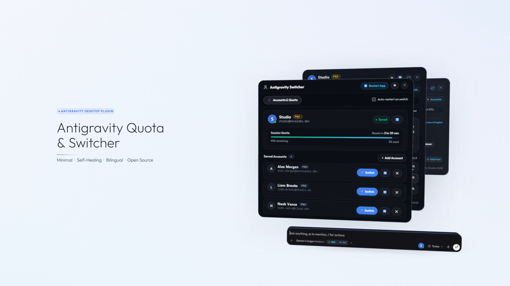
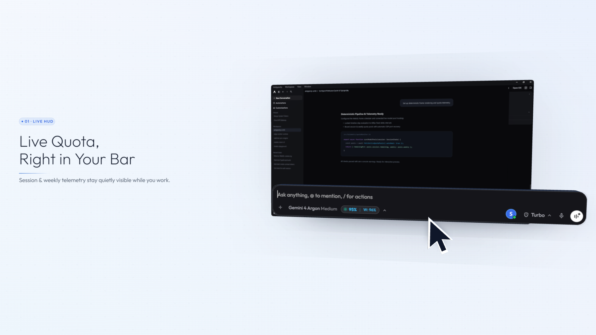
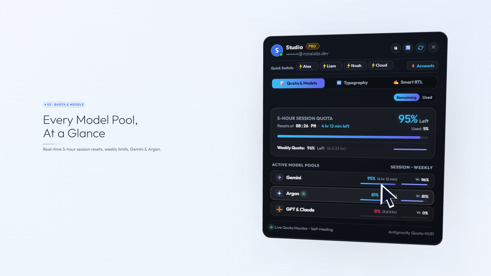
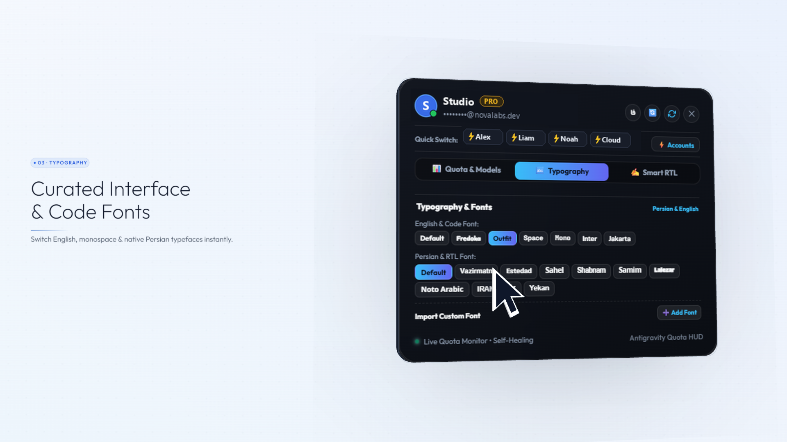
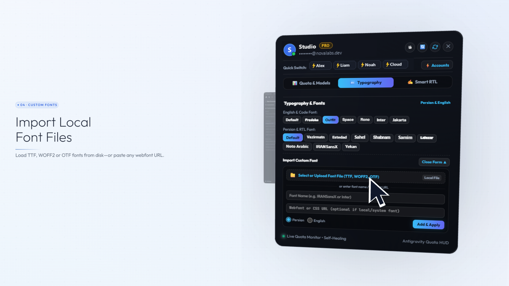
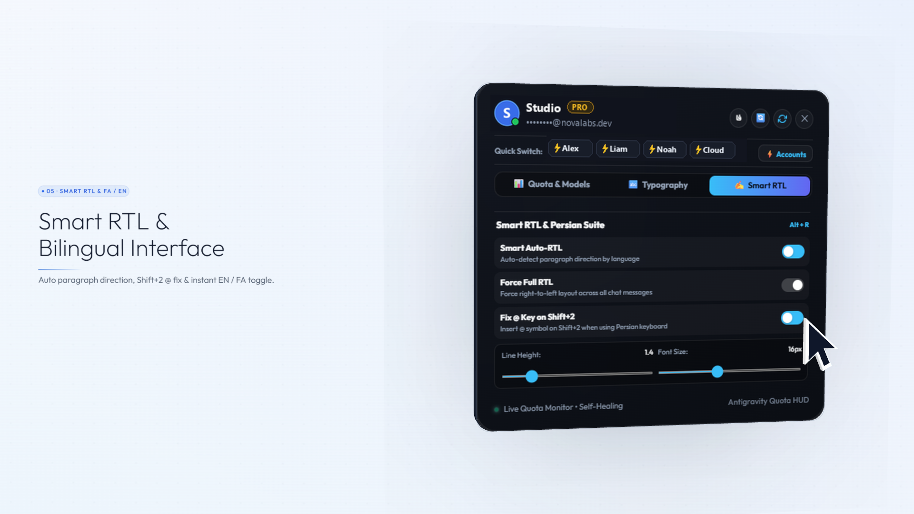
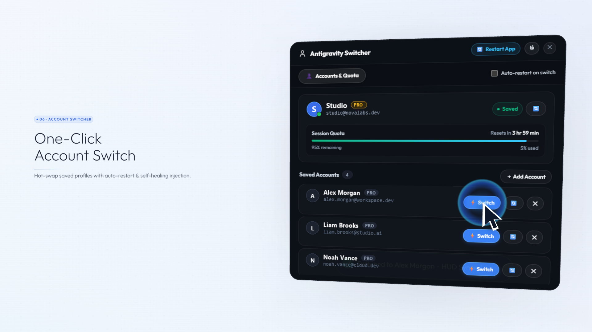
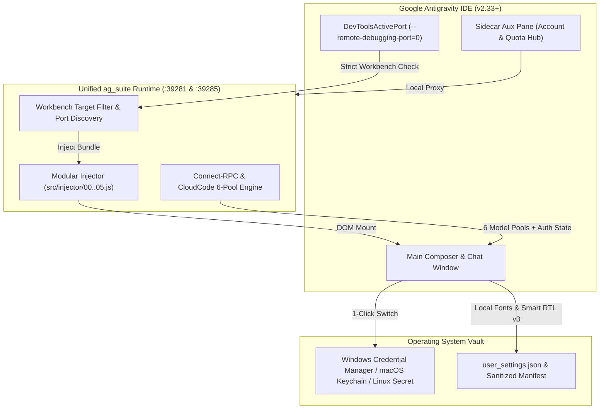

# Antigravity Quota HUD & Account Switcher v3.0 ⚡️

[](LICENSE)
[]()
[]()
[]()
[]()
[]()
[](https://github.com/mad-helpers)

> **Minimal, super-fast 1-click Google Account Switcher, 6-Pool Real-Time Quota HUD (Gemini 4 Hydrogen, Argon, Carbon & Orchestrator, Flash, Claude 4.6, GPT-OSS 120B), Smart Persian RTL v3 Suite, Native Antigravity 2.33+ Sidecar Aux Pane, and Custom Local Font Engine.**  
> Built with precision, liquid glass aesthetics, fluid 60fps physics, self-healing CDP injection (`--remote-debugging-port=0`), and native bilingual support (English & Persian).

<p align="center">
  
</p>

---

## 🎬 Official 1080p 60fps Feature Teaser

Experience the complete feature walkthrough—choreographed in **Three.js** with spatial 3D slab physics, mouse-driven interactions, subtle UI foley audio, and light **Outfit** typography.

<p align="center">
  <a href="assets/teaser.mp4">
    
    <br>
    <b>▶️ Click here to watch the full 1080p 60fps Teaser Video (`assets/teaser.mp4`)</b>
  </a>
</p>

---

## 🌟 Quick Navigation / منوی دسترسی سریع

- [English Overview & Architecture](#-installation)
- [فارسی (🇮🇷 مستندات جامع فارسی)](README_FA.md)
- [🚀 1-Line Installation](#-installation)
- [📸 Feature Showcase & Visual Tour](#-feature-showcase)
- [⌨️ CLI Reference (`agy-switch`, `agy-quota`)](#-cli-commands--utilities)
- [🤖 Model Context Protocol (MCP) & Native Sidecar Aux Pane](#-model-context-protocol-mcp-server--native-sidecar)
- [🛠 Architecture & Self-Healing Pipeline](#-architecture--how-it-works)
- [📄 License & Authors](#-license)

---

## 🚀 Installation

### 🪟 Windows 10 & 11 (PowerShell — Recommended)
Open Windows PowerShell (Run as standard user) and paste:
```powershell
irm https://raw.githubusercontent.com/mad-helpers/antigravity-account-switcher/main/install.ps1 | iex
```
*✨ What this script does automatically:*
- Deploys the unified `ag_suite/` core, local bundled `.woff2` fonts (`Vazirmatn`, `Estedad`, `Outfit`), and runtime daemon into `%USERPROFILE%\.gemini\antigravity\bin\`.
- Registers the self-healing background synchronization service (`sync_daemon.py` on `127.0.0.1:39281`).
- Installs the native Antigravity 2.33+ Plugin & Sidecar Aux Pane (`sidecar://antigravity-account-suite/account-suite/`).
- Adds global CLI binaries (`agy-switch` and `agy-quota`) to your user `PATH`.
- Configures `Launch-Antigravity.vbs` with `--remote-debugging-port=0` so Antigravity 2.33+ exposes `DevToolsActivePort` for live in-editor HUD and Smart RTL v3 injection.

### 🍏 macOS & 🐧 Linux (Bash)
Open your terminal and run:
```bash
curl -fsSL https://raw.githubusercontent.com/mad-helpers/antigravity-account-switcher/main/install.sh | bash
```

### 📦 Manual / Portable Setup
```bash
git clone https://github.com/mad-helpers/antigravity-account-switcher.git
cd antigravity-account-switcher

# Windows:
.\install.ps1

# macOS / Linux:
chmod +x install.sh && ./install.sh
```

---

## 📸 Feature Showcase

### 1. ⚡️ Live Quota HUD in Prompt Composer
<p align="center">
  
</p>

- **Discrete Status Capsule:** A modern, non-intrusive pill placed directly beside `Turbo` in the prompt composer (`● 95% | W: 96%`).
- **Amber Gold Activity Pulse:** Automatically radiates a warm golden glow (`#fbbf24`) whenever an active AI agent or model is streaming and consuming quota.
- **Online Service Dot & Session Mismatch Detection:** Real-time indicator verifying CDP daemon health and alerting immediately if the running IDE account differs from the OS Credential Vault (`session_mismatch`).

---

### 2. 📊 Real-Time 6-Pool Model Telemetry (v3.0)
<p align="center">
  
</p>

- **5-Hour Session Quota:** Real-time limit with live countdown timer (`Resets in 3 hr, 59 min`).
- **Weekly Quota:** 7-day aggregate burn rate indicator (`W: 96%`).
- **Complete 6-Pool 2026 Model Breakdown:**
  1. `Gemini 4 Hydrogen` (XHigh)
  2. `Gemini 4 Argon` (High)
  3. `Gemini 4 Carbon & Orchestrator`
  4. `Gemini 3.8 Flash`
  5. `Claude 4.6 (Opus & Sonnet)` (including `Claude 5.5` family)
  6. `GPT-OSS 120B`

---

### 3. 🔤 Curated Offline-First Interface & Code Fonts
<p align="center">
  
</p>

- **Bundled Local `.woff2` Fonts:** Ships `Vazirmatn[wght].woff2`, `Estedad[wght].woff2`, and `Outfit[wght].woff2` locally via `:39281/fonts/*` with zero startup CDN blocking.
- **Handcrafted Latin & Code Typefaces:** `Outfit`, `Inter`, `Space Grotesk`, `JetBrains Mono`, `Fredoka`, `Plus Jakarta Sans`.
- **10 Persian & Arabic Fonts:** `Vazirmatn (وزیرمتن)`, `Estedad (استعداد)`, `Sahel (ساحل)`, `Shabnam (شبنم)`, `Samim (صمیم)`, `Lalezar (لاله‌زار)`, `Noto Sans Arabic`, `IRANSansX`, `B Yekan`.

---

### 4. 📁 Local Font File Importer (.woff2, .ttf, .otf)
<p align="center">
  
</p>

- **Direct File Upload:** Pick any local `.woff2`, `.woff`, `.ttf`, or `.otf` font file directly from your disk.
- **Offline Persistence:** Automatically decodes and converts font files into offline Base64 Data URLs injected via the browser's native `FontFace API`.
- **Persistent Storage:** Stored across IDE restarts in both `user_settings.json` and `localStorage`, with single-click chip removal (`✕`).

---

### 5. ✍️ Smart Auto-RTL v3 & Bilingual Persian Suite
<p align="center">
  
</p>

- **Streaming-Aware Paragraph Auto-Direction:** `120ms`-debounced `MutationObserver` automatically aligns Persian/Arabic paragraphs, headings, lists, blockquotes, and tables right (`rtl`) while keeping English prose and code strictly `ltr`.
- **Lexical-Compatible Persian `@` Key Fix:** Fixes `Shift + 2` inside editor inputs to insert `@` cleanly via `InputEvent('beforeinput')` / `setRangeText` instead of `٬`.
- **Monospace Code & Math Isolation:** Markdown code blocks (`<pre>`, `<code>`), KaTeX formulas, and `file://` links are strictly isolated in LTR monospace while reasoning traces support `unicode-bidi: plaintext`.
- **Global Shortcut:** Press `Alt + R` to toggle Smart RTL on/off anywhere in the IDE.

---

### 6. ⚡️ One-Click Account Switcher, Project Payer & Sidecar Hub
<p align="center">
  
</p>

- **Instant Hot-Swap & Per-Project Quota Payer:** Switch between saved Google accounts in under 2 seconds or assign per-project quota payers directly from the modal, Control Center (`127.0.0.1:39285`), or native Sidecar Aux Pane (`sidecar://antigravity-account-suite/account-suite/`).
- **Self-Healing CDP Auto-Restart (`--remote-debugging-port=0`):** Optional automatic IDE restart with zero-downtime Chrome DevTools port re-discovery (`DevToolsActivePort`).
- **Native Bilingual UI (`EN / فا`):** Instant single-click header toggle between English and Persian across all surfaces.

---

## ⌨️ CLI Commands & Utilities

Global command-line tools are available out-of-the-box:

### 1. `agy-quota` — Visual Terminal 6-Pool Quota Dashboard
```bash
agy-quota                      # 📊 Display live session, weekly & 6-pool quotas with colored progress bars
agy-quota --status-json        # 🤖 Machine-readable JSON status for scripts & AI agents
agy-quota --list               # 📋 List all registered accounts and active status
```

### 2. `agy-switch` — Identity, Diagnostics & Project Management
```bash
agy-switch                                      # 🖥 Open the Liquid Glass Control Center (127.0.0.1:39285)
agy-switch --usage                              # 📊 Terminal overview of all 6 model pools
agy-switch --doctor                             # 🩺 Diagnose LS RPC, CDP (--remote-debugging-port=0), daemon & tokens
agy-switch --doctor --json                      # 🩺 Machine-readable diagnostic report
agy-switch --list                               # 📋 List registered accounts, token status, and active identity
agy-switch --switch developer@example.com       # ⚡️ Switch active identity in OS vault (in-place --no-restart default)
agy-switch --switch developer@example.com --restart # 🔄 Switch token and gracefully restart Antigravity with CDP flag
agy-switch --set-project-quota "my-project" developer@example.com # 💳 Assign project quota payer & switch OS credential
agy-switch --launch-instance instance_2         # 🪟 Launch or focus isolated concurrent Antigravity window
agy-switch --status-json                        # 🤖 Full JSON metadata dump (with auth_state & sanitized accounts)
agy-switch --save                               # 💾 Snapshot active session token to vault
agy-switch --logout                             # ➕ Log out active session to register new account
agy-switch --help                               # ℹ️ Display CLI options and usage
```

---

## 🤖 Model Context Protocol (MCP) Server & Native Sidecar

The suite includes a native Antigravity 2.33+ plugin (`plugin/`) with a zero-dependency stdio MCP server (`mcp_server.py` v3.0.0) and an Aux Pane Sidecar (`sidecar://antigravity-account-suite/account-suite/`).

### Registered MCP Tools (5 Tools):
| Tool Name | Description | Parameters |
| :--- | :--- | :--- |
| `get_quota_status` | Returns live 5-hour & weekly quota, all 6 model pools, `auth_state`, and sanitized accounts | `account` (string, optional), `include_all` (bool, optional) |
| `switch_account` | Switches active token in OS Credential Manager / Keychain | `account` (string, required), `no_restart` (bool, optional, default `true`) |
| `set_project_quota` | Configures designated Google account payer for a project and switches OS credential | `project` (string, required), `account` (string, required), `apply_now` (bool, optional, default `true`) |
| `list_saved_accounts` | Lists all registered accounts, tiers, `has_token`/`needs_reauth`, and active status | None |
| `diagnose_suite` | Runs full suite health check (`ok`, `auth_state`, `cdp`, `sync_daemon`, `control_center`, `fonts`, `accounts`, `issues`) | None |

### Configuration:
Installed automatically by `install.ps1` / `install.sh` into `~/.gemini/config/plugins/antigravity-account-suite/mcp_config.json`, or add manually:
```json
{
  "mcpServers": {
    "antigravity-account-suite": {
      "command": "python",
      "args": [
        "%USERPROFILE%\\.gemini\\antigravity\\bin\\mcp_server.py"
      ],
      "env": {
        "PYTHONIOENCODING": "utf-8"
      }
    }
  }
}
```

---

## 🛠 Architecture & How It Works



---

## 📄 License

Distributed under the **MIT License**. See `LICENSE` for details.

Developed with precision and pride by **[mad-helpers](https://github.com/mad-helpers)** ([Madgod-xyz](https://github.com/Madgod-xyz) & [Bombhub-apk](https://github.com/Bombhub-apk)).
