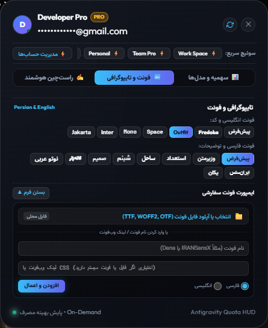
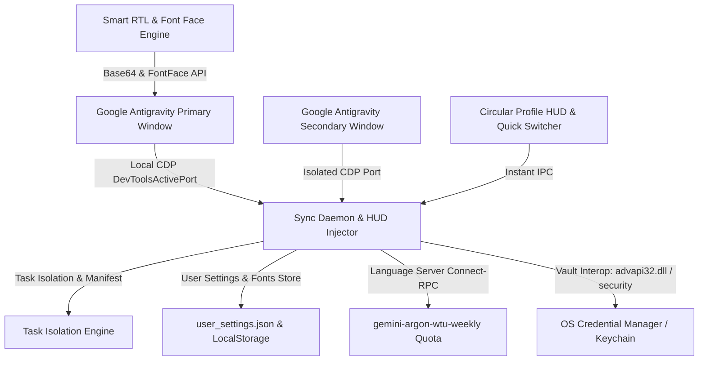

# Antigravity Account Switcher & Studio Suite ⚡️

[](LICENSE)
[]()
[]()
[]()
[]()
[]()
[](https://github.com/mad-helpers)

> **Super-fast 1-click Google Account Switcher, Concurrent Dual-Instance Runner, Live Quota HUD (Gemini, Argon, Claude/GPT), Smart Persian RTL Suite, and Custom Local Font Engine for Google Antigravity & ChatGPT Desktop / Codex.**  
> Built with precision, liquid glass aesthetics, fluid 60fps physics, and native multi-language support (English, Persian, Spanish, Chinese).

<p align="center">
  
</p>

---

## 🌟 Quick Navigation / منوی دسترسی سریع

- [English (🇬🇧 Overview & Features)](#-english)
- [فارسی (🇮🇷 مستندات جامع فارسی)](README_FA.md)
- [Español (🇪🇸 Descripción y Características)](#-español)
- [Installation & Quick Start](#-installation)
- [CLI Reference](#-cli-commands)
- [Architecture & Mechanics](#-architecture--how-it-works)

---

## 🚀 Installation

### 🪟 Windows 10 & 11 (PowerShell)
Open PowerShell as your standard user and run:
```powershell
irm https://raw.githubusercontent.com/mad-helpers/antigravity-account-switcher/master/install.ps1 | iex
```
*Installs background sync daemons, registers `agy-switch` and `agy-quota` in your PATH, and sets up desktop shortcuts.*

### 🍏 macOS (Apple Silicon M1/M2/M3/M4 & Intel)
Open Terminal and run:
```bash
curl -fsSL https://raw.githubusercontent.com/mad-helpers/antigravity-account-switcher/master/install.sh | bash
```
*Installs the CLI suite and desktop switcher app.*

---

## 🇬🇧 English

### Overview
Switching between multiple Google accounts on **Google Antigravity** can be tedious because session credentials are bound inside **Windows Credential Manager** (`service: "gemini"`, `account: "antigravity"`) or **macOS Keychain**.

**Antigravity Account Switcher & Studio Suite** by **[mad-helpers](https://github.com/mad-helpers)** (co-owned by **[Madgod-xyz](https://github.com/Madgod-xyz)** & **[Bombhub-apk](https://github.com/Bombhub-apk)**) delivers a high-performance native cross-platform solution (in-editor circular HUD pill, instant account switching, multi-instance dual window concurrency, Smart RTL typography, and custom font file importing).

### ✨ Key Features

1. 👤 **Circular Profile Indicator & Active Quota Glow**:
   - Modern 26px circular avatar/initial pill placed directly beside `Turbo` in the prompt composer bar.
   - Shows live connection status (green indicator dot) and active identity.
   - Automatically pulses with an amber gold glowing ring (`#fbbf24`) whenever an AI model or subagent is active and consuming quota.

2. 📊 **Live Model Pools HUD (Gemini, Argon, GPT & Claude)**:
   - Streamlined 3-pool view displaying live remaining percentage and reset countdowns:
     - **Gemini**: 5h session and weekly pool quotas.
     - **Argon**: Dedicated Antigravity Language Server Connect-RPC telemetry (`gemini-argon-wtu-weekly`) tracking `gemini-4-argon` remaining capacity and exact weekly reset days.
     - **GPT & Claude**: Combined session and weekly metrics for Claude Sonnet 4.6 and GPT-OSS 120B.

3. 🇮🇷 **Smart RTL & Persian Typography Engine**:
   - Automatic bidirectional paragraph direction detection: Persian and Arabic paragraphs align right; English paragraphs, inline code, and symbols align left.
   - Preserves codeblocks (`<pre>`, `<code>`), LaTeX math formulas, and markdown tables.
   - Fixes `@` mention dropdown positioning and bidirectional caret alignment.
   - **Built-in Persian Fonts**: Vazirmatn, Estedad, Sahel, Shabnam, Samim, Lalezar, Noto Sans Arabic, IRANSansX, B Yekan.
   - **Built-in English Fonts**: Outfit, Inter, Space Grotesk, JetBrains Mono, Fredoka, Plus Jakarta Sans.

4. 📁 **Local Font File Importer (.woff2, .woff, .ttf, .otf)**:
   - Direct font file picker supporting local `.woff2`, `.woff`, `.ttf`, and `.otf` font files.
   - Automatically detects format and deduces clean font names.
   - Converts files to offline Base64 Data URLs and dynamically registers them via `@font-face` and the native `FontFace API`.
   - Persisted across app restarts in both `user_settings.json` and `localStorage`, with single-click chip deletion.
   - Also supports local system font names and external webfont CSS URLs.

5. ⚡️ **Instant 1-Click In-Editor Account Switching**:
   - Quick-switch chips inside the popover to instantly switch between stored accounts in under 2 seconds without reloading the window.
   - Full-featured Switcher Modal for managing accounts, tokens, and multi-account workflows.

6. 🪟 **Dual-Instance Concurrent Multi-Window**:
   - Open a 2nd Antigravity window with a secondary Google account (`--user-data-dir="%APPDATA%\Antigravity-Instance2"`).
   - Work simultaneously on separate projects with independent credentials, tasks, and brain databases.

7. 🛡 **Auto-Healing CDP Daemon**:
   - Local background sync daemon running on port `39281`.
   - Automatically detects Antigravity DevTools debugging port via `DevToolsActivePort`.
   - Non-blocking asynchronous event loop with health watchdog.

---

## ⌨️ CLI Commands & Utilities

Global CLI tools are automatically registered in `%USERPROFILE%\.gemini\bin` (Windows) and `/usr/local/bin` (macOS/Linux):

### 1. `agy-quota` — Dedicated Quota HUD
```bash
agy-quota                      # 📊 Display live session & weekly quotas with colored bars
agy-quota --status-json        # 🤖 Machine-readable JSON status for scripts & agents
agy-quota --list               # 📋 List all registered accounts and active status
```

### 2. `agy-switch` — Full Account & Project Suite
```bash
agy-switch                                      # 🖥 Open the Desktop GUI
agy-switch --usage                              # 📊 Terminal dashboard of live model limits
agy-switch --list                               # 📋 List registered accounts with active status
agy-switch --switch <email>                     # ⚡️ Switch active identity in OS Credential Manager
agy-switch --switch <email> --no-restart        # 🔄 Switch credential without restarting IDE
agy-switch --set-project-quota <proj> <email>   # 💳 Assign designated quota payer for project
agy-switch --launch-instance <slot_or_email>    # 🚀 Launch or focus isolated instance (e.g. instance_2)
agy-switch --status-json                        # 🤖 Full JSON payload (active quota, manifest, instances)
agy-switch --save                               # 💾 Save active session token to manifest
agy-switch --logout                             # ➕ Log out active session to add a new account
agy-switch --help                               # ℹ️ Display help and command syntax
```

---

## 🤖 Model Context Protocol (MCP) Server

The suite includes a lightweight stdio MCP server (`mcp_server.py`) allowing autonomous coding agents (Google Antigravity, Claude Code, Gemini CLI, Cursor, VS Code) to inspect quotas and manage identities programmatically.

### Registered MCP Tools:
| Tool Name | Description | Parameters |
| :--- | :--- | :--- |
| `get_quota_status` | Returns live quota, 5-hour session reset timer, weekly limit, and per-model stats | `account` (optional string), `include_all` (optional bool) |
| `switch_account` | Switches active token in OS Credential Manager / Keychain | `account` (required string), `no_restart` (optional bool) |
| `set_project_quota` | Configures designated Google account payer for a project | `project` (required string), `account` (required string) |
| `list_saved_accounts` | Lists all registered accounts, tiers, quotas, and active status | None |

### Configuration Snippet:
Add to your IDE or agent config (`settings.json` or `mcp_config.json`):
```json
{
  "mcpServers": {
    "antigravity-account-suite": {
      "command": "python",
      "args": [
        "%USERPROFILE%\\.gemini\\antigravity\\bin\\mcp_server.py"
      ],
      "env": {
        "PYTHONIOENCODING": "utf-8"
      }
    }
  }
}
```

---

## 🛠 Architecture & How It Works



---

## 📄 License
Distributed under the **MIT License**. See `LICENSE` for details.

Developed with precision and care by **[mad-helpers](https://github.com/mad-helpers)** ([Madgod-xyz](https://github.com/Madgod-xyz) & [Bombhub-apk](https://github.com/Bombhub-apk)).
