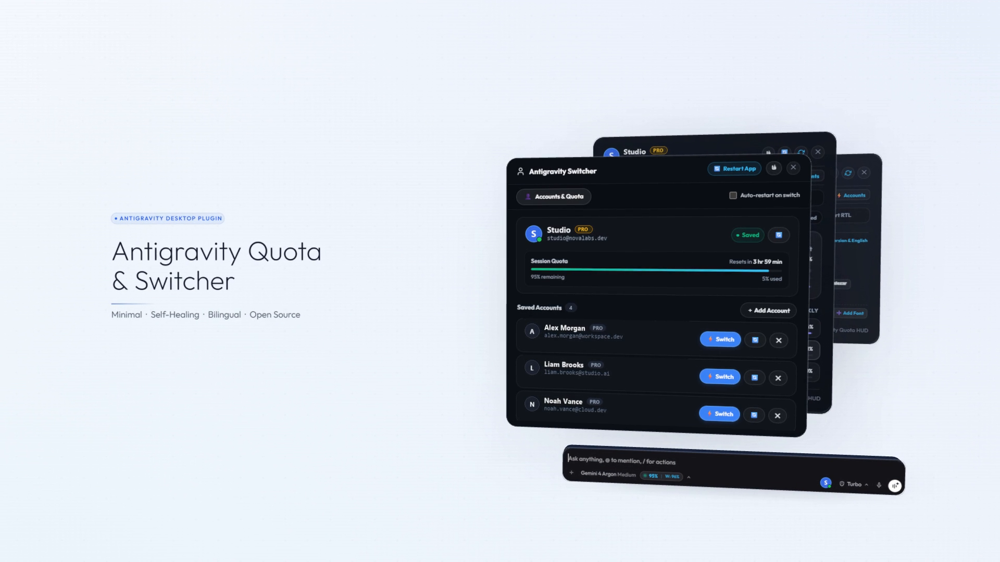
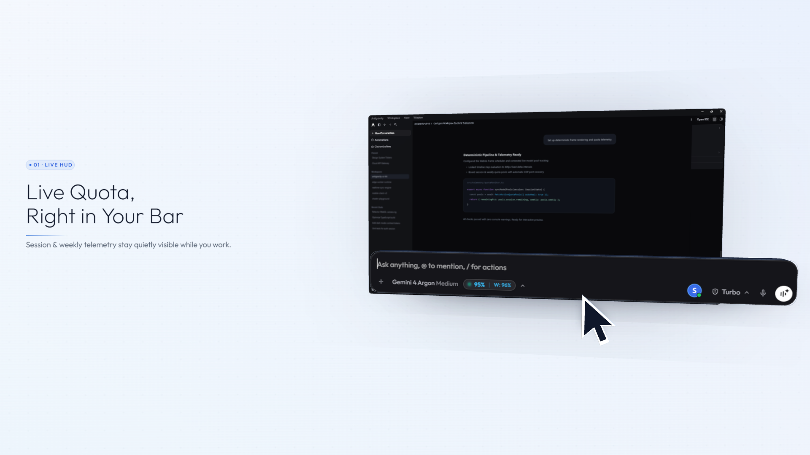
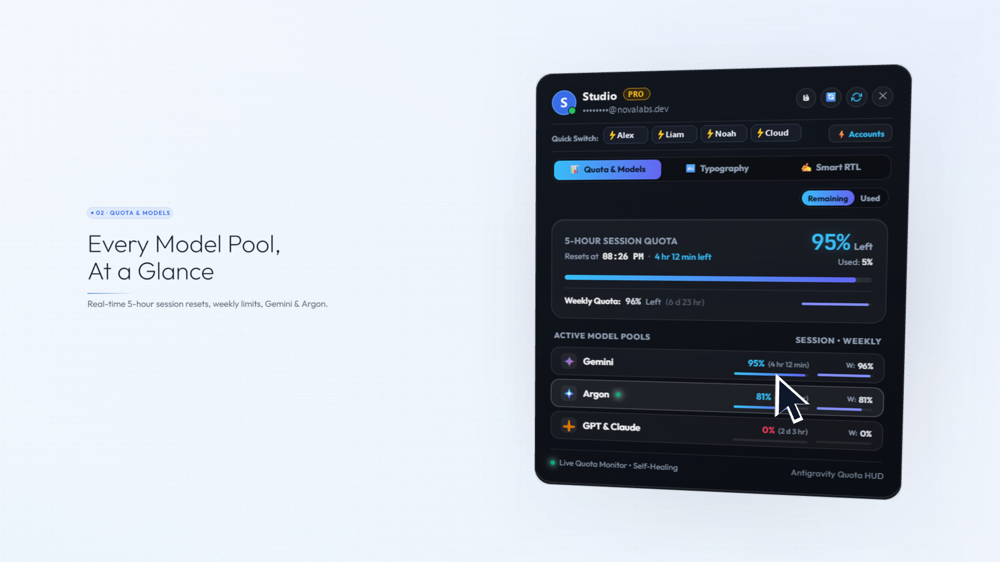
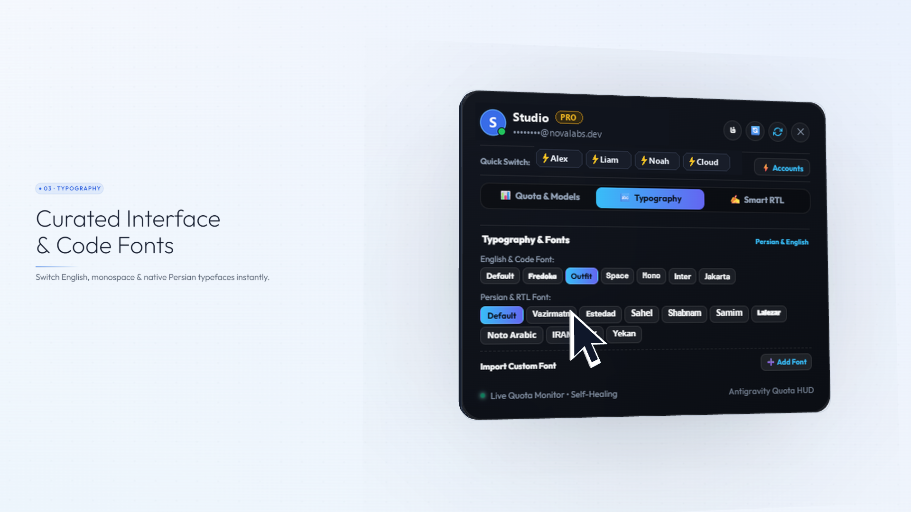
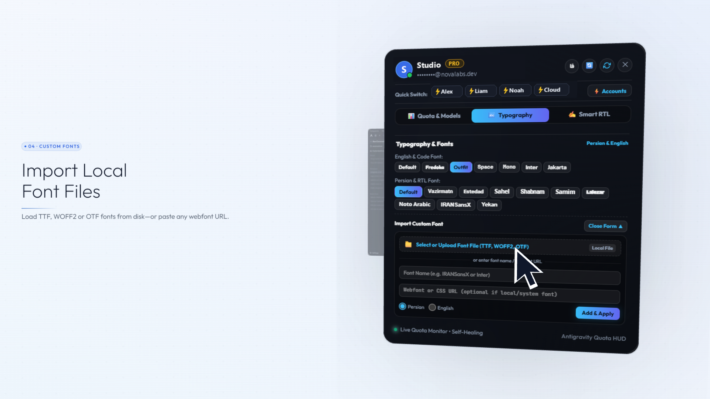
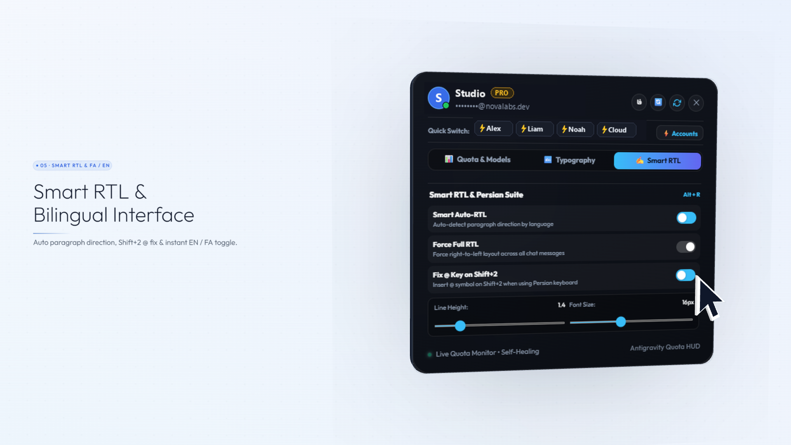
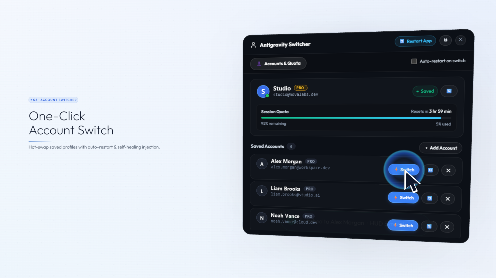
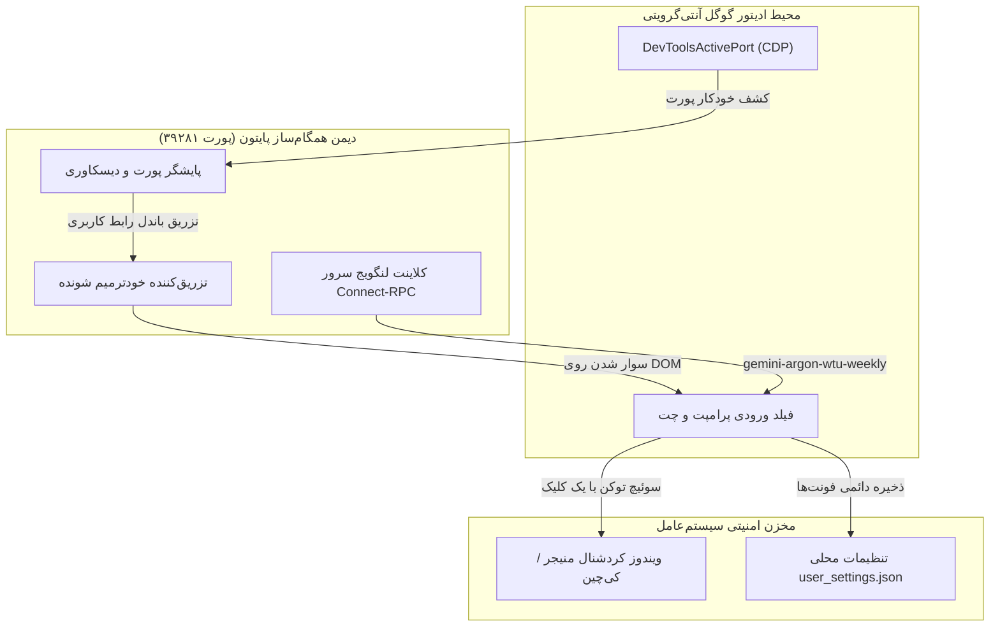

# سوئیت مدیریت اکانت، پایش زنده سهمیه و تایپوگرافی آنتی‌گرویتی ⚡️

[](LICENSE)
[]()
[]()
[]()
[]()
[]()
[](https://github.com/mad-helpers)

> **سوئیت سبک، مدرن و پرسرعت برای سوئیچ ۱-کلیکه اکانت‌های گوگل در گوگل آنتی‌گرویتی، نمایش زنده سهمیه مدل‌ها در نوار پرامپت (Gemini، Argon و Claude/GPT)، موتور راست‌چین هوشمند پاراگراف‌ها (Smart RTL)، اصلاح کلید `@` در کیبورد فارسی، آپلود مستقیم فایل‌های فونت محلی و رابط کاربری کاملاً دوزبانه (فارسی و انگلیسی).**  
> توسعه‌یافته با بالاترین استاندارد مهندسی نرم‌افزار، معماری خودترمیم‌شونده CDP و انیمیشن‌های فلوید ۶۰ فریم بر ثانیه توسط تیم **[mad-helpers](https://github.com/mad-helpers)** (با مالکیت مشترک **[Madgod-xyz](https://github.com/Madgod-xyz)** و **[Bombhub-apk](https://github.com/Bombhub-apk)**).

<p align="center">
  
</p>

---

## 🎬 ویدیوی رسمی معرفی محصول (کیفیت 1080p و ۶۰ فریم)

تیزر معرفی تعاملی محصول با موتور **Three.js**، فیزیک سه‌بعدی اسلب‌ها، سناریوی گام‌به‌گام با محوریت نشانگر موس، طراحی صدای مینیمال سوییچ‌های فیزیکی و تایپوگرافی ظریف **Outfit** ساخته شده است:

<p align="center">
  <a href="assets/teaser.mp4">
    
    <br>
    <b>▶️ جهت تماشای ویدیوی معرفی با کیفیت ۱۰۸۰p و ۶۰ فریم کلیک کنید (`assets/teaser.mp4`)</b>
  </a>
</p>

---

## 🌟 فهرست دسترسی سریع

- [مستندات انگلیسی (🇬🇧 English Documentation)](README.md)
- [🚀 راهنمای نصب سریع ۱-خطی](#-راهنمای-نصب-سریع)
- [📸 تور دیداری و بررسی قابلیت‌ها](#-تور-دیداری-و-بررسی-قابلیت‌ها)
- [⌨️ دستورات خط فرمان (`agy-switch`, `agy-quota`)](#-راهنمای-دستورات-خط-فرمان-cli)
- [🤖 سرور پروتکل زمینه مدل (MCP Server)](#-پروتکل-mcp-برای-ایجنت‌های-هوش-مصنوعی)
- [🛠 معماری فنی و پایپ‌لاین خودترمیم](#-معماری-فنی-و-نحوه-کارکرد)
- [📄 لایسنس و حقوق نرم‌افزار](#-لایسنس)

---

## 🚀 راهنمای نصب سریع

### 🪟 ویندوز ۱۰ و ۱۱ (از طریق PowerShell — روش پیشنهادی)
پاورشل را به‌صورت کاربر عادی باز کنید و دستور زیر را اجرا نمایید:
```powershell
irm https://raw.githubusercontent.com/mad-helpers/antigravity-account-switcher/master/install.ps1 | iex
```
*✨ این اسکریپت به‌صورت کاملاً خودکار عملیات زیر را انجام می‌دهد:*
- ثبت سرویس همگام‌ساز پس‌زمینه و دیمن نظارتی خودترمیم (`sync_daemon.py`).
- ثبت ابزارهای خط فرمان سراسری `agy-switch` و `agy-quota` در متغیر محیطی `PATH`.
- نصب باندل رابط کاربری در مسیر `%USERPROFILE%\.gemini\antigravity\`.
- اتصال خودکار و مقاوم به پورت دیباگ آنتی‌گرویتی از طریق `DevToolsActivePort`.

### 🍏 مک‌او‌اس و 🐧 لینوکس (Bash)
ترمینال را باز کرده و دستور زیر را وارد کنید:
```bash
curl -fsSL https://raw.githubusercontent.com/mad-helpers/antigravity-account-switcher/master/install.sh | bash
```

### 📦 نصب دستی یا پرتابل
```bash
git clone https://github.com/mad-helpers/antigravity-account-switcher.git
cd antigravity-account-switcher

# در ویندوز:
.\install.ps1

# در مک یا لینوکس:
chmod +x install.sh && ./install.sh
```

---

## 📸 تور دیداری و بررسی قابلیت‌ها

### ۱. ⚡️ نوار سهمیه زنده (HUD) در فیلد پرامپت
<p align="center">
  
</p>

- **کپسول وضعیت ظریف و بدون مزاحمت:** جای‌گیری مستقیم کنار دکمه Turbo در نوار ورودی چت (`● 95% | W: 96%`).
- **پالس نوری طلایی/کهربایی:** در لحظاتی که مدل یا ساب‌ایجنت در حال پردازش یا مصرف توکن است، هاله‌ای نرم و زردرنگ (`#fbbf24`) دور کپسول روشن می‌شود تا کاربر در جریان فعالیت زنده سیستم قرار گیرد.
- **نشانگر سبز سلامت سرویس:** تاییدیه بلادرنگ اتصال فعال اینجکتور و دریافت سالم داده‌ها از CDP.

---

### ۲. 📊 جدول پایش بلادرنگ سهمیه مدل‌ها
<p align="center">
  
</p>

- **سهمیه دوره‌ای ۵ ساعته:** نمایش دقیق درصد باقیمانده به همراه تایمر معکوس ریست بعدی (`Resets in 3 hr, 59 min`).
- **سهمیه هفتگی (Weekly Quota):** پایش نرخ مصرف تجمعی ۷ روزه (`W: 96%`).
- **تله‌متری مستقیم آرگون (Argon Connect-RPC):** اتصال اختصاصی به لنگویج سرور آنتی‌گرویتی از طریق Connect-RPC (`gemini-argon-wtu-weekly`) جهت سنجش دقیق سهمیه مدل `gemini-4-argon` و اعلام دقیق روزهای باقیمانده تا ریست.
- **پایش یکپارچه کلود و GPT:** پشتیبانی کامل از Claude Sonnet و GPT-OSS 120B.

---

### ۳. 🔤 فونت‌های دست‌چین رابط کاربری و کدنویسی
<p align="center">
  
</p>

- **فونت‌های انگلیسی و مونو مدرن:** `Outfit`، `Inter`، `Space Grotesk`، `JetBrains Mono`، `Fredoka`، `Plus Jakarta Sans`.
- **۱۰ فونت پیش‌فرض فارسی و عربی:** `وزیرمتن (Vazirmatn)`، `استعداد (Estedad)`، `ساحل (Sahel)`، `شبنم (Shabnam)`، `صمیم (Samim)`، `لاله‌زار (Lalezar)`، `نوتو عربی (Noto Sans Arabic)`، `ایران‌سنس (IRANSansX)`، `بی یکان (B Yekan)`.
- **اعمال آنی بدون رفرش:** با کلیک روی هر چیپ فونت، تمام متون چت و استایل‌های ادیتور بلافاصله به فونت جدید تغییر وضعیت می‌دهند.

---

### ۴. 📁 آپلود مستقیم فایل‌های فونت محلی (.woff2, .ttf, .otf)
<p align="center">
  
</p>

- **انتخاب مستقیم فایل از روی سیستم:** امکان انتخاب هر فایل با فرمت‌های رایج `.woff2`، `.woff`، `.ttf` و `.otf`.
- **پایداری آفلاین با Base64:** تبدیل خودکار فایل به دیتای Base64 و ثبت مستقیم در استایل‌های ادیتور با استفاده از استاندارد مدرن مرورگر `FontFace API`.
- **پشتیبانی از وب‌فونت و فونت‌های سیستمی:** قابلیت تایپ نام هر فونت نصب‌شده در ویندوز یا وارد کردن لینک فایل CSS آنلاین.
- **ذخیره دائمی:** ثبت همزمان در `localStorage` و دیسک محلی (`user_settings.json`) به‌طوری که پس از ری‌استارت سیستم همواره فعال باقی می‌ماند.

---

### ۵. ✍️ راست‌چین هوشمند (Smart RTL) و بسته تخصصی فارسی
<p align="center">
  
</p>

- **تشخیص خودکار زبان در هر پاراگراف:** پاراگراف‌های فارسی و عربی به‌صورت طبیعی و زیبا راست‌چین (`rtl`) می‌شوند و پاراگراف‌های انگلیسی، نام فایل‌ها و فرمول‌ها چپ‌چین (`ltr`) باقی می‌مانند.
- **حل قطعی کلید `@` در کیبورد فارسی:** در کیبورد استاندارد فارسی فشردن `Shift + 2` به جای علامت ویرگول فارسی (`٬`)، مستقیماً کاراکتر `@` را درج می‌کند تا منشن کردن فایل‌ها و ابزارها بدون تغییر زبان کیبورد انجام پذیرد.
- **ایزوله‌سازی دقیق بلوک‌های کد و ریاضیات:** بلاک‌های کد (`pre`، `code`)، کادرهای تفکر مدل (`thinking`) و فرمول‌های LaTeX کاتک به هیچ وجه دستخوش بهم‌ریختگی نمی‌شوند.
- **اسلایدرهای اختصاصی ظاهر:** کنترل روان فاصله بین خطوط (Line Height) و اندازه فونت (Font Size).
- **کلید میانبر سراسری:** فشردن `Alt + R` در هر نقطه‌ای از ادیتور راست‌چین هوشمند را خاموش یا روشن می‌کند.

---

### ۶. ⚡️ سوئیچ تک‌کلیکی اکانت‌ها و رابط کاربری دوزبانه
<p align="center">
  
</p>

- **تغییر هویت در کمتر از ۲ ثانیه:** انتخاب سریع حساب فعال از طریق چیپ‌های سوئیچ سریع زیر هدر یا مودال جامع اکانت‌ها.
- **راه‌اندازی مجدد با اتصال خودکار (Self-Healing):** گزینه اختیاری ری‌استارت خودکار نرم‌افزار پس از تغییر هویت با قابلیت اتصال آنی مجدد از طریق پایشگر `DevToolsActivePort`.
- **سوییچ آنی زبان رابط کاربری (`EN / فا`):** دکمه تغییر زبان در هدر پنجره که تمام متن‌ها، دکمه‌ها و تولتیپ‌ها را در لحظه بین فارسی و انگلیسی تغییر می‌دهد.
- **همخوانی با امنیت سیستم‌عامل:** ارتباط امن با Windows Credential Manager در ویندوز و Keychain در مک‌او‌اس.

---

## ⌨️ راهنمای دستورات خط فرمان (CLI)

ابزارهای خط فرمان به صورت سراسری در ترمینال قابل استفاده هستند:

### ۱. دستور `agy-quota` — مشاهده تله‌متری سهمیه در ترمینال
```bash
agy-quota                      # 📊 نمایش نمودارهای رنگی مصرف سشن و سهمیه هفتگی
agy-quota --status-json        # 🤖 خروجی ساختاریافته JSON برای اسکریپت‌ها و ایجنت‌ها
agy-quota --list               # 📋 فهرست حساب‌های ثبت‌شده و اکانت فعال
```

### ۲. دستور `agy-switch` — مدیریت اکانت‌ها و پروژه‌ها
```bash
agy-switch                                      # 🖥 باز کردن پنجره گرافیکی مدیریت
agy-switch --usage                              # 📊 مشاهده وضعیت سهمیه مدل‌ها در ترمینال
agy-switch --list                               # 📋 لیست تمام حساب‌ها و شناسه فعال
agy-switch --switch developer@example.com       # ⚡️ تغییر اکانت فعال در ویندوز کردشنال منیجر
agy-switch --switch developer@example.com --no-restart # 🔄 سوئیچ توکن بدون ری‌استارت ادیتور
agy-switch --set-project-quota "my-project" developer@example.com # 💳 تخصیص حساب سهمیه به پروژه
agy-switch --status-json                        # 🤖 استخراج کامل متادیتای سیستم به صورت JSON
agy-switch --save                               # 💾 ذخیره توکن سشن فعال در مخزن اکانت‌ها
agy-switch --logout                             # ➕ خروج از حساب جهت افزودن حساب جدید
agy-switch --help                               # ℹ️ راهنمای کامل دستورات و گزینه‌ها
```

---

## 🤖 پروتکل MCP برای ایجنت‌های هوش مصنوعی

این بسته شامل یک سرور سبک و بدون پیش‌نیاز استاندارد MCP (`mcp_server.py`) برای گوگل آنتی‌گرویتی، کلود کد، جمینای CLI، کرسر و VS Code است:

### ابزارهای تعریف‌شده:
| نام ابزار | کارکرد | پارامترها |
| :--- | :--- | :--- |
| `get_quota_status` | استعلام درصد باقیمانده، زمان ریست سشن ۵ ساعته و سهمیه هفتگی | `account` (اختیاری), `include_all` (اختیاری) |
| `switch_account` | سوئیچ توکن هویت در کردشنال منیجر سیستم‌عامل | `account` (اجباری), `no_restart` (اختیاری) |
| `set_project_quota` | تعیین حساب پرداخت‌کننده سهمیه برای یک پروژه مشخص | `project` (اجباری), `account` (اجباری) |
| `list_saved_accounts` | فهرست کامل اکانت‌های ذخیره‌شده و وضعیت فعال | ندارد |

### پیکربندی در فایل تنظیمات ایجنت (`settings.json` یا `mcp_config.json`):
```json
{
  "mcpServers": {
    "antigravity-account-suite": {
      "command": "python",
      "args": [
        "%USERPROFILE%\\.gemini\\antigravity\\bin\\mcp_server.py"
      ],
      "env": {
        "PYTHONIOENCODING": "utf-8"
      }
    }
  }
}
```

---

## 🛠 معماری فنی و نحوه کارکرد



---

## 📄 لایسنس

این پروژه تحت مجوز متن‌باز **MIT** منتشر شده است. جهت مطالعه جزئیات بیشتر به فایل `LICENSE` مراجعه کنید.

طراحی و پیاده‌سازی شده با افتخار توسط تیم **[mad-helpers](https://github.com/mad-helpers)** ([Madgod-xyz](https://github.com/Madgod-xyz) و [Bombhub-apk](https://github.com/Bombhub-apk)).
