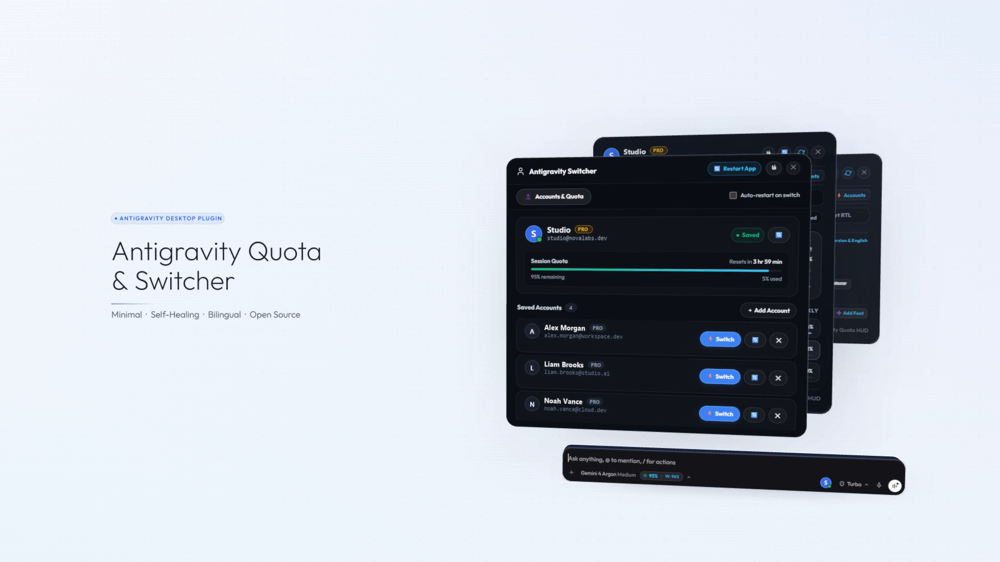
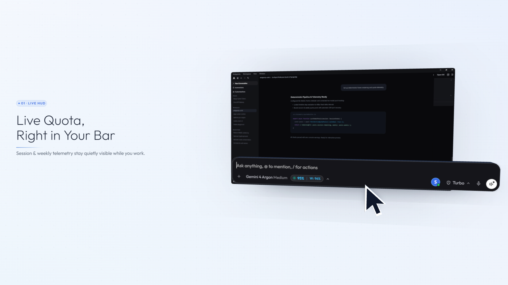
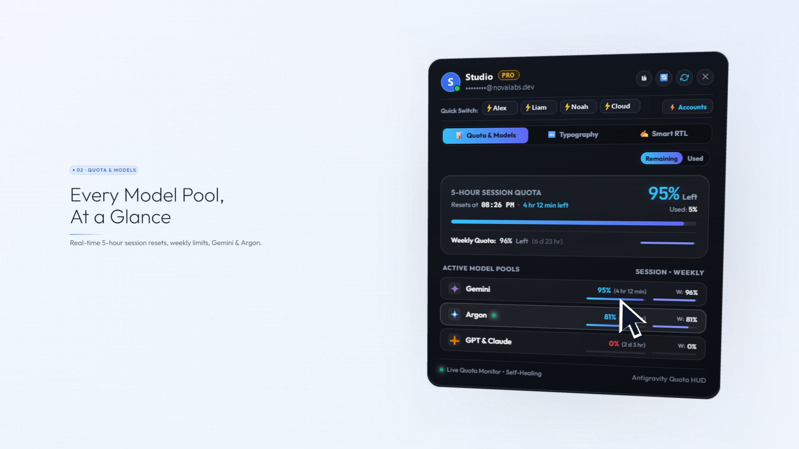
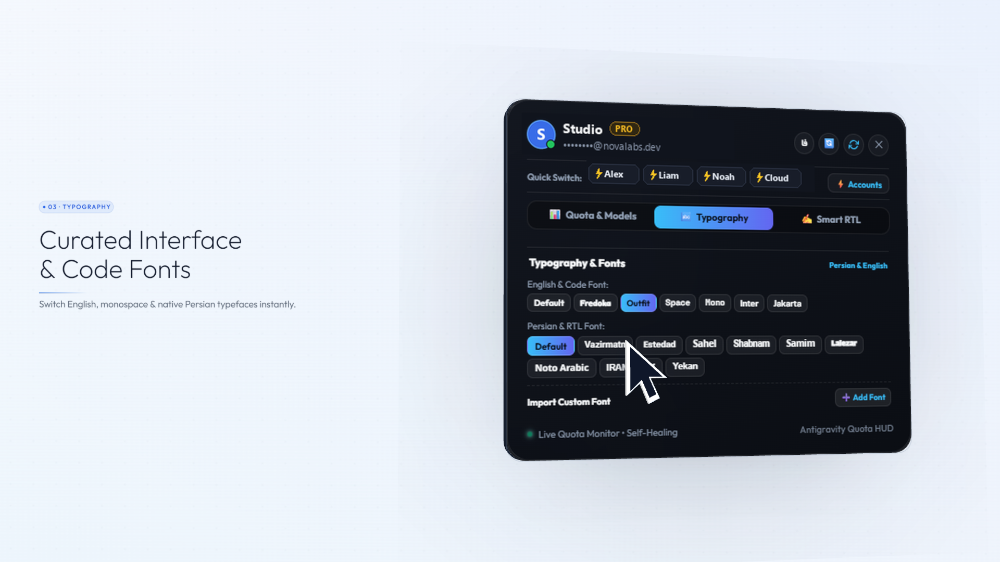
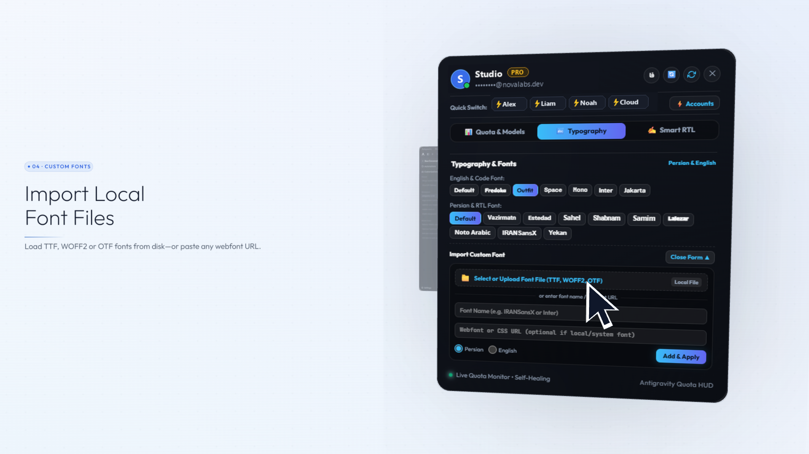
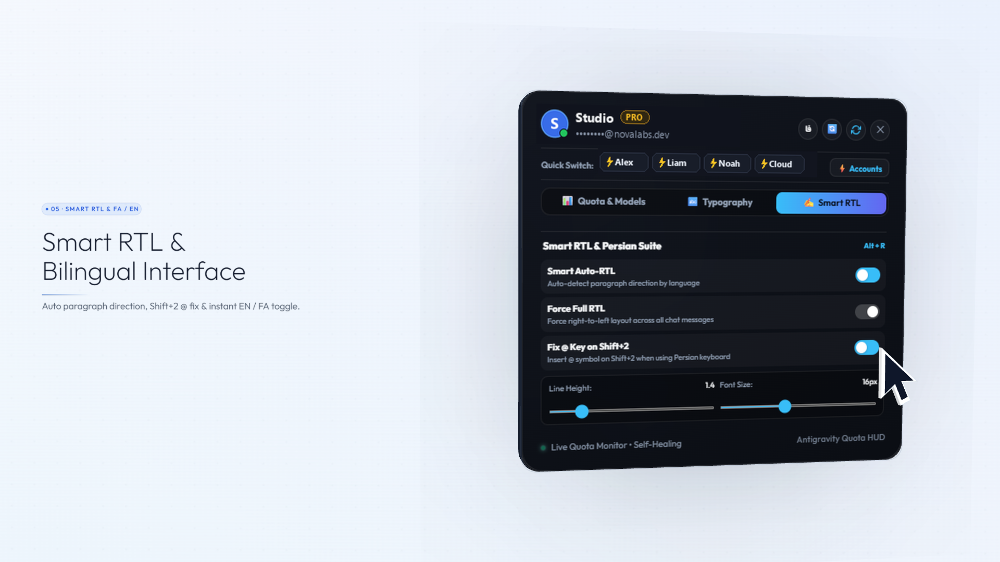
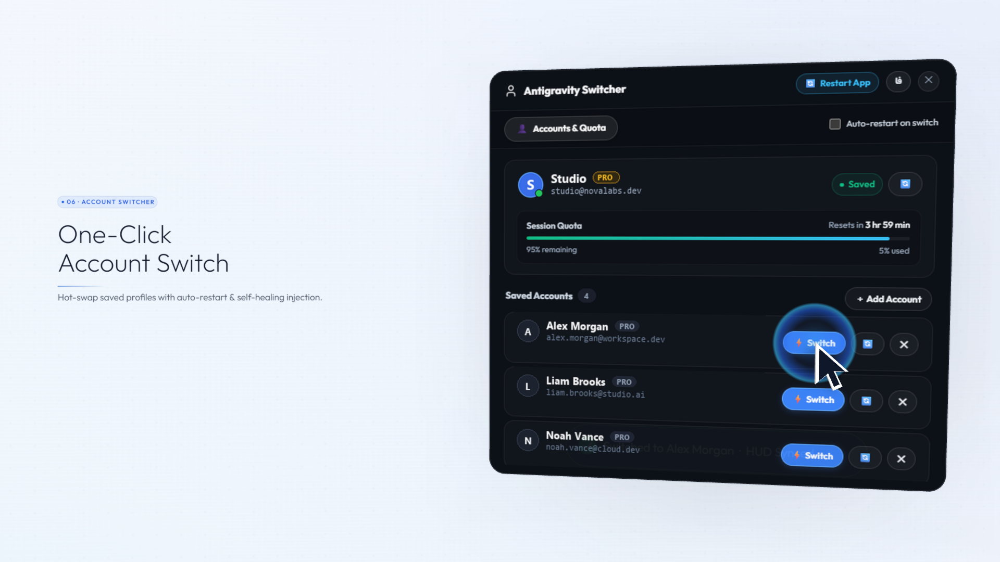

# سوئیت مدیریت اکانت، پایش زنده ۶ استخر سهمیه و تایپوگرافی آنتی‌گرویتی v3.0 ⚡️

[](LICENSE)
[]()
[]()
[]()
[]()
[]()
[](https://github.com/mad-helpers)

> **سوئیت بومی، سبک و پرسرعت برای سوئیچ ۱-کلیکه اکانت‌های گوگل در گوگل آنتی‌گرویتی، نمایش زنده سهمیه ۶ استخر مدل در نوار پرامپت (`Gemini 4 Hydrogen`، `Gemini 4 Argon`، `Gemini 4 Carbon & Orchestrator`، `Gemini 3.8 Flash`، `Claude 4.6` و `GPT-OSS 120B`)، موتور راست‌چین هوشمند نسخه ۳ (Smart RTL v3)، پنل جانبی بومی (Sidecar Aux Pane)، اصلاح کلید `@` در کیبورد فارسی و موتور فونت آفلاین.**  
> توسعه‌یافته با بالاترین استاندارد مهندسی نرم‌افزار، معماری خودترمیم‌شونده CDP (`--remote-debugging-port=0`) و انیمیشن‌های فلوید ۶۰ فریم بر ثانیه توسط تیم **[mad-helpers](https://github.com/mad-helpers)** (با مالکیت مشترک **[Madgod-xyz](https://github.com/Madgod-xyz)** و **[Bombhub-apk](https://github.com/Bombhub-apk)**).

<p align="center">
  
</p>

---

## 🎬 ویدیوی رسمی معرفی محصول (کیفیت 1080p و ۶۰ فریم)

تیزر معرفی تعاملی محصول با موتور **Three.js**، فیزیک سه‌بعدی اسلب‌ها، سناریوی گام‌به‌گام با محوریت نشانگر موس، طراحی صدای مینیمال سوییچ‌های فیزیکی و تایپوگرافی ظریف **Outfit** ساخته شده است:

<p align="center">
  <a href="assets/teaser.mp4">
    
    <br>
    <b>▶️ جهت تماشای ویدیوی معرفی با کیفیت ۱۰۸۰p و ۶۰ فریم کلیک کنید (`assets/teaser.mp4`)</b>
  </a>
</p>

---

## 🌟 فهرست دسترسی سریع

- [مستندات انگلیسی (🇬🇧 English Documentation)](README.md)
- [🚀 راهنمای نصب سریع ۱-خطی](#-راهنمای-نصب-سریع)
- [📸 تور دیداری و بررسی قابلیت‌ها](#-تور-دیداری-و-بررسی-قابلیت‌ها)
- [⌨️ دستورات خط فرمان (`agy-switch`, `agy-quota`)](#-راهنمای-دستورات-خط-فرمان-cli)
- [🤖 سرور پروتکل MCP و پنل جانبی بومی (Sidecar)](#-پروتکل-mcp-و-پنل-جانبی-بومی-برای-ایجنت‌های-هوش-مصنوعی)
- [🛠 معماری فنی و پایپ‌لاین خودترمیم](#-معماری-فنی-و-نحوه-کارکرد)
- [📄 لایسنس و حقوق نرم‌افزار](#-لایسنس)

---

## 🚀 راهنمای نصب سریع

### 🪟 ویندوز ۱۰ و ۱۱ (از طریق PowerShell — روش پیشنهادی)
پاورشل را به‌صورت کاربر عادی باز کنید و دستور زیر را اجرا نمایید:
```powershell
irm https://raw.githubusercontent.com/mad-helpers/antigravity-account-switcher/main/install.ps1 | iex
```
*✨ این اسکریپت به‌صورت کاملاً خودکار عملیات زیر را انجام می‌دهد:*
- نصب هسته یکپارچه `ag_suite/`، فونت‌های آفلاین محلی (`Vazirmatn`، `Estedad`، `Outfit`) و سرویس همگام‌ساز پس‌زمینه (`sync_daemon.py` روی `127.0.0.1:39281`).
- نصب پلاگین بومی Antigravity 2.33+ و پنل جانبی `Account & Quota Hub` (`sidecar://antigravity-account-suite/account-suite/`).
- ثبت ابزارهای خط فرمان سراسری `agy-switch` و `agy-quota` در متغیر محیطی `PATH`.
- پیکربندی `Launch-Antigravity.vbs` با پرچم `--remote-debugging-port=0` جهت فعال‌سازی خودکار `DevToolsActivePort` و تزریق زنده HUD و Smart RTL v3.

### 🍏 مک‌او‌اس و 🐧 لینوکس (Bash)
ترمینال را باز کرده و دستور زیر را وارد کنید:
```bash
curl -fsSL https://raw.githubusercontent.com/mad-helpers/antigravity-account-switcher/main/install.sh | bash
```

### 📦 نصب دستی یا پرتابل
```bash
git clone https://github.com/mad-helpers/antigravity-account-switcher.git
cd antigravity-account-switcher

# در ویندوز:
.\install.ps1

# در مک یا لینوکس:
chmod +x install.sh && ./install.sh
```

---

## 📸 تور دیداری و بررسی قابلیت‌ها

### ۱. ⚡️ نوار سهمیه زنده (HUD) در فیلد پرامپت
<p align="center">
  
</p>

- **کپسول وضعیت ظریف و بدون مزاحمت:** جای‌گیری مستقیم کنار دکمه Turbo در نوار ورودی چت (`● 95% | W: 96%`).
- **پالس نوری طلایی/کهربایی:** در لحظاتی که مدل یا ساب‌ایجنت در حال پردازش یا مصرف توکن است، هاله‌ای نرم و زردرنگ (`#fbbf24`) دور کپسول روشن می‌شود.
- **نشانگر سلامت سرویس و تشخیص عدم تطابق نشست (`session_mismatch`):** پایش لحظه‌ای تطابق حساب فعال در ادیتور با کلید ذخیره‌شده در سیستم‌عامل.

---

### ۲. 📊 جدول پایش بلادرنگ ۶ استخر سهمیه مدل‌ها (v3.0)
<p align="center">
  
</p>

- **سهمیه دوره‌ای ۵ ساعته و هفتگی:** نمایش دقیق درصد باقیمانده به همراه تایمر معکوس ریست بعدی.
- **تفکیک کامل ۶ استخر مدل ۲۰۲۶:**
  1. `Gemini 4 Hydrogen` (XHigh)
  2. `Gemini 4 Argon` (High)
  3. `Gemini 4 Carbon & Orchestrator`
  4. `Gemini 3.8 Flash`
  5. `Claude 4.6 (Opus & Sonnet)` (شامل خانواده `Claude 5.5`)
  6. `GPT-OSS 120B`

---

### ۳. 🔤 فونت‌های آفلاین دست‌چین رابط کاربری و کدنویسی
<p align="center">
  
</p>

- **فونت‌های محلی باندل‌شده (بدون وابستگی به اینترنت در استارتاپ):** فونت‌های `Vazirmatn[wght].woff2`، `Estedad[wght].woff2` و `Outfit[wght].woff2` به‌صورت محلی از مسیر `/fonts/*` سرو می‌شوند.
- **۱۰ فونت فارسی و عربی + ۶ فونت انگلیسی و مونو:** اعمال آنی بدون رفرش صفحه.

---

### ۴. 📁 آپلود مستقیم فایل‌های فونت محلی (.woff2, .ttf, .otf)
<p align="center">
  
</p>

- **انتخاب مستقیم فایل از روی سیستم:** پشتیبانی از فرمت‌های `.woff2`، `.woff`، `.ttf` و `.otf` با ذخیره‌سازی پایدار آفلاین.

---

### ۵. ✍️ راست‌چین هوشمند نسخه ۳ (Smart RTL v3) و بسته تخصصی فارسی
<p align="center">
  
</p>

- **تشخیص خودکار زبان در حین استریم پاسخ مدل:** ناظر `MutationObserver` با دیبانس `120ms` پاراگراف‌ها، تیترها، لیست‌ها، نقل‌قول‌ها و جداول فارسی را راست‌چین (`rtl`) کرده و متون انگلیسی و کدها را چپ‌چین (`ltr`) نگه می‌دارد.
- **حل قطعی کلید `@` در ادیتورهای مدرن Lexical:** درج مستقیم کاراکتر `@` با فشردن `Shift + 2` در کیبورد فارسی.
- **ایزوله‌سازی دقیق کدها و فرمول‌ها + کلید میانبر `Alt + R`.**

---

### ۶. ⚡️ سوئیچ تک‌کلیکی اکانت‌ها، تخصیص سهمیه پروژه و پنل جانبی
<p align="center">
  
</p>

- **تغییر هویت در کمتر از ۲ ثانیه و انتخاب پرداخت‌کننده سهمیه پروژه (Quota Payer):** از طریق مودال داخل ادیتور، مرکز کنترل (`127.0.0.1:39285`) یا پنل جانبی بومی (`sidecar://antigravity-account-suite/account-suite/`).

---

## ⌨️ راهنمای دستورات خط فرمان (CLI)

### ۱. دستور `agy-quota` — مشاهده تله‌متری ۶ استخر سهمیه در ترمینال
```bash
agy-quota                      # 📊 نمایش نمودارهای رنگی مصرف سشن، هفتگی و ۶ استخر مدل
agy-quota --status-json        # 🤖 خروجی ساختاریافته JSON برای اسکریپت‌ها و ایجنت‌ها
agy-quota --list               # 📋 فهرست حساب‌های ثبت‌شده و اکانت فعال
```

### ۲. دستور `agy-switch` — مدیریت اکانت‌ها، عیب‌یابی و پروژه‌ها
```bash
agy-switch                                      # 🖥 باز کردن مرکز کنترل شیشه‌ای (127.0.0.1:39285)
agy-switch --usage                              # 📊 مشاهده وضعیت سهمیه ۶ استخر مدل در ترمینال
agy-switch --doctor                             # 🩺 عیب‌یابی کامل سرویس‌ها، پورت CDP (--remote-debugging-port=0) و توکن‌ها
agy-switch --doctor --json                      # 🩺 خروجی JSON عیب‌یابی سیستم
agy-switch --list                               # 📋 لیست تمام حساب‌ها، سلامت توکن و شناسه فعال
agy-switch --switch developer@example.com       # ⚡️ تغییر اکانت فعال در مخزن سیستم‌عامل (پیش‌فرض بدون ری‌استارت)
agy-switch --switch developer@example.com --restart # 🔄 سوئیچ توکن همراه با ری‌استارت امن ادیتور با پرچم CDP
agy-switch --set-project-quota "my-project" developer@example.com # 💳 تخصیص حساب سهمیه به پروژه و سوئیچ خودکار کردشنال
agy-switch --launch-instance instance_2         # 🪟 اجرای پنجره همزمان و مجزای آنتی‌گرویتی
agy-switch --status-json                        # 🤖 استخراج کامل متادیتای سیستم به صورت JSON
agy-switch --save                               # 💾 ذخیره توکن سشن فعال در مخزن اکانت‌ها
agy-switch --logout                             # ➕ خروج از حساب جهت افزودن حساب جدید
agy-switch --help                               # ℹ️ راهنمای کامل دستورات و گزینه‌ها
```

---

## 🤖 پروتکل MCP و پنل جانبی بومی برای ایجنت‌های هوش مصنوعی

این بسته شامل پلاگین بومی Antigravity 2.33+ (`plugin/`)، سرور استاندارد MCP (`mcp_server.py` نسخه `3.0.0`) و پنل جانبی `Account & Quota Hub` (`sidecar://antigravity-account-suite/account-suite/`) است:

### ۵ ابزار تعریف‌شده در MCP:
| نام ابزار | کارکرد | پارامترها |
| :--- | :--- | :--- |
| `get_quota_status` | استعلام درصد باقیمانده، سشن ۵ ساعته، هفتگی، ۶ استخر مدل و `auth_state` | `account` (اختیاری), `include_all` (اختیاری) |
| `switch_account` | سوئیچ توکن هویت در کردشنال منیجر / کی‌چین سیستم‌عامل | `account` (اجباری), `no_restart` (اختیاری، پیش‌فرض `true`) |
| `set_project_quota` | تعیین حساب پرداخت‌کننده سهمیه برای پروژه و سوئیچ خودکار کردشنال | `project` (اجباری), `account` (اجباری), `apply_now` (اختیاری، پیش‌فرض `true`) |
| `list_saved_accounts` | فهرست کامل اکانت‌های ذخیره‌شده، `has_token`/`needs_reauth` و وضعیت فعال | ندارد |
| `diagnose_suite` | عیب‌یابی کامل (`ok`, `auth_state`, `cdp`, `sync_daemon`, `control_center`, `fonts`, `accounts`, `issues`) | ندارد |

---

## 📄 لایسنس

این پروژه تحت مجوز متن‌باز **MIT** منتشر شده است. جهت مطالعه جزئیات بیشتر به فایل `LICENSE` مراجعه کنید.

طراحی و پیاده‌سازی شده با افتخار توسط تیم **[mad-helpers](https://github.com/mad-helpers)** ([Madgod-xyz](https://github.com/Madgod-xyz) و [Bombhub-apk](https://github.com/Bombhub-apk)).
