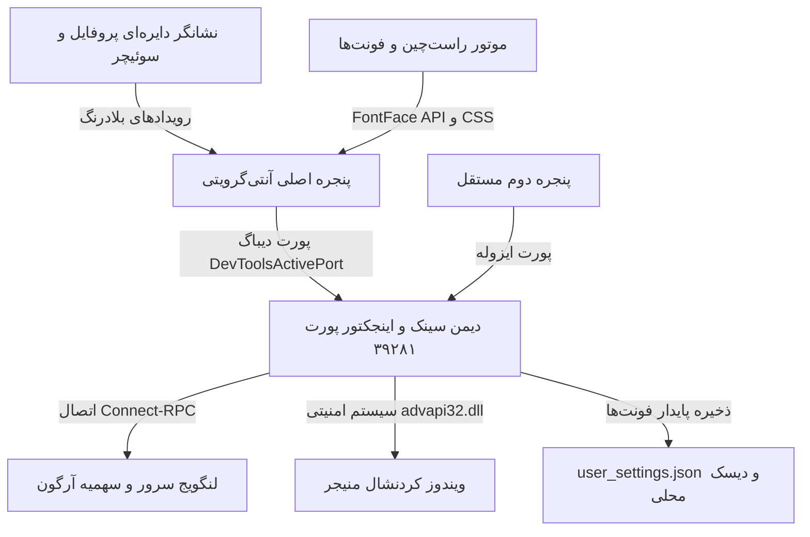

# سوئیت مدیریت اکانت، پایش سهمیه و تایپوگرافی پیشرفته آنتی‌گرویتی (Antigravity Studio Suite) ⚡️

[](LICENSE)
[]()
[]()
[]()
[]()
[](https://github.com/mad-helpers)

> **سوئیت جامع و پرسرعت برای سوئیچ ۱-کلیکه اکانت‌های گوگل در آنتی‌گرویتی، پایش دقیق سهمیه‌ها (Gemini، Argon و GPT & Claude)، طراحی مدرن دکمه پروفایل با پالس طلایی مصرف، موتور هوشمند راست‌چین (Smart RTL) و سیستم آپلود و ایمپورت مستقیم فایل‌های فونت محلی (WOFF2/TTF/OTF).**  
> توسعه‌یافته توسط تیم **[mad-helpers](https://github.com/mad-helpers)** (با مالکیت مشترک **[Madgod-xyz](https://github.com/Madgod-xyz)** و **[Bombhub-apk](https://github.com/Bombhub-apk)**).

<p align="center">
  
</p>

---

## 🌟 فهرست دسترسی سریع

- [قابلیت‌های برجسته و تغییرات نسخه جدید](#-قابلیت‌های-برجسته-نسخه-جدید)
- [المان پروفایل گرد و هاله زرد پالس‌زن](#۱-نشانگر-پروفایل-گرد-و-هاله-پالس-در-زمان-مصرف)
- [پایش زنده سهمیه‌ها (Gemini، Argon و GPT & Claude)](#۲-جدول-سهمیه‌ها-و-پایش-دقیق-آرگون-argon)
- [موتور راست‌چین هوشمند (Smart RTL)](#۳-موتور-راست‌چین-هوشمند-smart-rtl)
- [تایپوگرافی و ایمپورت مستقیم فایل‌های فونت](#۴-تایپوگرافی-و-ایمپورت-مستقیم-فایل‌های-فونت)
- [سوئیچ آنی اکانت در ادیتور](#۵-سوئیچ-سریع-اکانت-در-محیط-ادیتور)
- [اجرای همزمان دو پنجره مستقل](#۶-اجرای-همزمان-دو-پنجره-مستقل-dual-instance)
- [نصب و راه‌اندازی سریع](#-نصب-و-راه‌اندازی-سریع)
- [دستورات خط فرمان (CLI)](#-راهنمای-دستورات-خط-فرمان-cli)
- [پروتکل MCP برای ایجنت‌های هوش مصنوعی](#-پروتکل-mcp-و-مهارت-ایجنت)

---

## 🚀 قابلیت‌های برجسته نسخه جدید

### ۱. نشانگر پروفایل گرد و هاله پالس در زمان مصرف
- جایگزینی المان‌های متنی شلوغ با **یک دایره پروفایل مینیمال ۲۶ پیکسلی** که دقیقاً در نوار پرامپت و **کنار دکمه Turbo** قرار گرفته است.
- نمایش حرف اول یا آواتار اکانت فعال به همراه نقطه سبز آنلاین بودن سرویس.
- **پالس نورانی طلایی/کهربایی (`#fbbf24`)**: در لحظاتی که ایجنت در حال اجرای تسک یا کسر سهمیه است، دور نشانگر پروفایل به‌صورت پالس نئونی زرد روشن می‌شود تا کاربر متوجه فعالیت زنده مدل گردد.

### ۲. جدول سهمیه‌ها و پایش دقیق آرگون (Argon)
- ساختار ساده، تمیز و حرفه‌ای مدل‌ها در ۳ دسته اصلی:
  - **Gemini**: نمایش سهمیه سشن ۵ ساعته و سهمیه هفتگی به همراه تایمر شمارش معکوس ریست.
  - **Argon**: اتصال مستقیم به لنگویج سرور آنتی‌گرویتی از طریق Connect-RPC (`gemini-argon-wtu-weekly`) برای پایش زنده مدل `gemini-4-argon` و اعلام دقیق درصد باقیمانده و روزهای تا ریست.
  - **GPT & Claude**: پایش مشترک سهمیه‌های مربوط به مدل‌های کلود و مدل‌های مبتنی بر کدکس.

### ۳. موتور راست‌چین هوشمند (Smart RTL)
- **تشخیص خودکار جهت زبان**: پاراگراف‌های حاوی کلمات فارسی و عربی به‌صورت خودکار راست‌چین (`rtl`) و متن‌های انگلیسی چپ‌چین (`ltr`) می‌شوند.
- **ایزوله‌سازی کدها و فرمول‌ها**: بلوک‌های کد (`pre`، `code`)، جدول‌های مارک‌داون، فرمول‌های ریاضی کاتک (`.katex`) و لینک‌ها هرگز چپ‌به‌راست به‌هم نمی‌ریزند.
- **رفع مشکل علامت `@`**: پاپ‌آپ انتخاب مدل‌ها و منشن‌ها در محل صحیح ظاهر شده و تداخل جهت کرسر حل شده است.
- کلید میانبر سریع **Alt + R** جهت فعال یا غیرفعال‌سازی آنی.

### ۴. تایپوگرافی و ایمپورت مستقیم فایل‌های فونت
- **مجموعه فونت‌های آماده فارسی**: وزیرمتن (Vazirmatn)، استعداد (Estedad)، ساحل (Sahel)، شبنم (Shabnam)، صمیم (Samim)، لاله‌زار (Lalezar)، نوتو عربی (Noto Sans Arabic)، ایران‌سنس (IRANSansX) و یکان (B Yekan).
- **فونت‌های انگلیسی و کدنویسی**: Outfit، Inter، Space Grotesk، JetBrains Mono، Fredoka، Plus Jakarta Sans.
- **📁 انتخاب و آپلود فایل فونت محلی**:
  - کاربر می‌تواند مستقیماً هر فایل فونت با پسوندهای `.woff2`, `.woff`, `.ttf`, `.otf` را از روی ویندوز انتخاب کند.
  - نام فونت و فرمت آن به‌صورت خودکار تشخیص داده می‌شود.
  - فایل به صورت دیتای Base64 ذخیره شده و از طریق قاعده `@font-face` و استاندارد نیتیو مرورگر `FontFace API` بلافاصله به استایل‌های برنامه تزریق می‌شود.
  - تنظیمات هم در `localStorage` و هم در فایل دیسک `user_settings.json` ذخیره می‌شوند و با ری‌استارت پایدار می‌مانند.
  - هر فونت اضافه شده با یک تگ و دکمه ضربدر ✕ برای حذف سریع در دسترس است.

### ۵. سوئیچ سریع اکانت در محیط ادیتور
- اضافه شدن چیپ‌های سوئیچ سریع زیر هدر پنجره پاپ‌اور: با یک کلیک روی ایمیل حساب ذخیره‌شده، توکن‌های سیستم تغییر کرده و بدون رفرش پنجره، هویت فعال عوض می‌شود.
- مودال مدیریت پیشرفته حساب‌ها (Switcher Modal) برای اضافه کردن یا مهاجرت تسک‌ها و فایل‌ها.

### ۶. اجرای همزمان دو پنجره مستقل (Dual-Instance)
- امکان باز کردن یک پنجره کاملاً مستقل از آنتی‌گرویتی با ایمیل دوم و دایرکتوری داده ایزوله (`--user-data-dir="%APPDATA%\Antigravity-Instance2"`).
- کار همزمان روی پروژه‌های شخصی و شرکتی روی یک مانیتور بدون تداخل سهمیه و نشست‌ها.

---

## 🚀 نصب و راه‌اندازی سریع

### 🪟 ویندوز ۱۰ و ۱۱ (از طریق پاورشل)
یک پنجره PowerShell باز کرده و دستور زیر را اجرا کنید:
```powershell
irm https://raw.githubusercontent.com/mad-helpers/antigravity-account-switcher/master/install.ps1 | iex
```
*این دستور دیمن همگام‌ساز پس‌زمینه را ثبت کرده و دستورات `agy-switch` و `agy-quota` را در محیط ویندوز فعال می‌کند.*

---

## ⌨️ راهنمای دستورات خط فرمان (CLI)

### ۱. دستور `agy-quota` — مشاهده گرافیکی سهمیه‌ها در ترمینال
```bash
agy-quota                      # نمایش نوار وضعیت مصرف و زمان ریست مدل‌ها
agy-quota --status-json        # خروجی جیسون ماشین‌خوان برای اسکریپت‌ها
agy-quota --list               # لیست حساب‌های متصل
```

### ۲. دستور `agy-switch` — مدیریت کامل هویت‌ها
```bash
agy-switch                                      # باز کردن داشبورد گرافیکی
agy-switch --usage                              # داشبورد ترمینال محدودیت‌های مدل
agy-switch --list                               # فهرست اکانت‌ها و وضعیت فعال
agy-switch --switch <email>                     # سوئیچ فعال در Credential Manager
agy-switch --switch <email> --no-restart        # سوئیچ توکن بدون بستن ادیتور
agy-switch --launch-instance instance_2         # اجرای مستقیم پنجره دوم
agy-switch --status-json                        # دریافت متادیتای کامل سیستم
```

---

## 🤖 پروتکل MCP و مهارت ایجنت

این سوئیت شامل یک سرور استاندارد سبک MCP (`mcp_server.py`) برای اتصال به ایجنت‌های هوش مصنوعی (Antigravity, Claude Code, Cursor) است:

### ابزارهای ارائه‌شده:
| نام ابزار | کارکرد | پارامترها |
| :--- | :--- | :--- |
| `get_quota_status` | دریافت درصد باقیمانده، سهمیه ۵ ساعته و هفتگی و مدل‌ها | `account`, `include_all` |
| `switch_account` | تغییر هویت فعال در Credential Manager ویندوز | `account`, `no_restart` |
| `set_project_quota` | تعیین حساب کسر سهمیه به ازای هر پروژه | `project`, `account` |
| `list_saved_accounts` | فهرست اکانت‌های ثبت‌شده و سطح اشتراک | ندارد |

---

## 🛠 معماری فنی و نحوه کارکرد



---

## 📄 لایسنس
توسعه‌یافته تحت **لایسنس MIT**. جهت اطلاعات بیشتر فایل `LICENSE` را مطالعه فرمایید.

طراحی و پیاده‌سازی شده با افتخار توسط تیم **[mad-helpers](https://github.com/mad-helpers)** ([Madgod-xyz](https://github.com/Madgod-xyz) و [Bombhub-apk](https://github.com/Bombhub-apk)).
